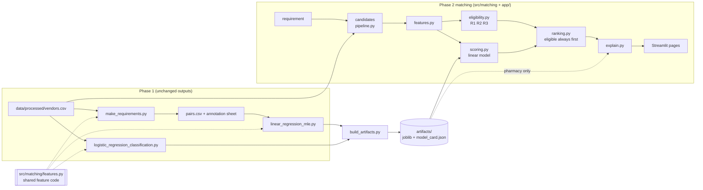

# Intelligent Agent Mapping: Vendor Matching — Phases 1 and 2

Phase 1 is limited to maximum likelihood estimation (MLE), linear regression
(least squares / RSS, Gaussian likelihood) and logistic regression for
classification. It uses a single snapshot (2026-09-27) of Google Maps place
records for 23 retail categories between South Chennai and Chengalpattu.

Phase 2 is a working vendor-matching prototype in Streamlit built on the Phase 1
models: deterministic eligibility rules, then the saved linear model's predicted
score, with explanations from real values. See [Phase 2](#phase-2-vendor-matching-prototype).

## Setup

Requires Python 3.14.7 (all pinned packages ship Python 3.14 wheels).

```powershell
python -m venv .venv
.venv\Scripts\activate
python -m pip install -r requirements.txt
```

On Git Bash use `source .venv/Scripts/activate`; on macOS/Linux use
`source .venv/bin/activate`.

Run every script from the project root.

## Conventions

- **Random seed:** 42, used for every sampler, split and estimator.
- **Raw data is read-only.** `Dataset/` holds the original files and
  `data/raw/` holds a byte-identical copy (verified by SHA-256). Scripts read
  `data/raw/` and never write to it. Derived data goes to `data/processed/`
  and `data/annotation/` only.
- **Text encoding:** all files are read and written as UTF-8, so Tamil and
  other Unicode shop names and addresses are preserved.
- **Fitted transforms** (vocabularies, encoders, scalers) are fitted on the
  training split only.
- `count` and `outside` in the raw file headers are file metadata only and
  are never used as features or targets.

## Pipeline

| Step | Command | Output |
|---|---|---|
| 0 Audit | `python src/audit.py` | `reports/audit.md` |
| 2 Preprocessing | `python src/preprocessing.py` | `data/processed/vendors.csv` |
| 3 Requirements + annotation pack | `python src/make_requirements.py` | `data/processed/requirements.csv`, `data/annotation/` |
| 4 Logistic regression (MLE) | `python src/logistic_regression_classification.py` | `reports/classification_metrics.json`, `reports/classification_coefficients.csv`, `data/annotation/label_audit_sample.csv`; explained in `notebooks/02_logistic_mle.ipynb` |
| 4b Re-score vs AI-judged labels | `python src/label_audit_rescore.py` | `reports/label_audit_metrics.json`. Uses the AI-judged `expected_is_pharmacy` column of `data/annotation/label_audit_sample.csv` |
| 5 Linear regression (Gaussian MLE) | `python src/linear_regression_mle.py`, `python src/linear_regression_plots.py` | `reports/regression_metrics.json`, `reports/figures/`; explained in `notebooks/03_linear_mle.ipynb`. Target: the AI-judged `expected_score`. Fits only once ≥300 rows have one, otherwise records the step as blocked |
| 6 Results | `python src/phase1_report.py` | `reports/phase1_results.md`, `reports/metrics.json` |
| 7 Extended Unit-II models | `python src/extended_models.py` | `reports/extended_models_metrics.json`: ridge, Huber, Bayesian linear, kernel ridge, LDA, naive Bayes, Bayesian logistic (Laplace), SVMs |
| 8 Viva pack | `python src/make_viva_pack.py` | `graphs/01–19`, `viva/00_key_numbers.md` (notes in `viva/`) |

Notebooks are re-executed with `jupyter nbconvert --to notebook --execute --inplace notebooks/<name>.ipynb`.

## Decisions and deviations from the original spec

- **Script names** follow the agreed structure: `preprocessing.py` (spec:
  `data_prep.py`), `logistic_regression_classification.py` (spec:
  `classify.py`), `linear_regression_mle.py` + `linear_regression_plots.py`
  (spec: `regress.py`). Step order is unchanged.
- **Processed vendor table is CSV, not parquet** (`data/processed/vendors.csv`,
  UTF-8), so no `pyarrow` dependency. `categories` is a sorted,
  `;`-separated string.
- **Unpenalised logistic regression uses `C=np.inf`** instead of
  `penalty=None`. Both mean "no regularisation", but `penalty` is deprecated in
  scikit-learn 1.9.1 and will be removed in 1.10.
- **Classification split is a stratified 80/20 split** (`train_test_split`,
  `stratify=y`, `random_state=42`) instead of "GroupShuffleSplit stratified by
  label". `GroupShuffleSplit` cannot stratify, and the vendor table has exactly
  one row per id, so grouping by id is already satisfied. The script asserts
  that no id is in both train and test.
- **The regression target is AI-judged (owner's decision change).** The locked rule
  "scores come only from human raters" was replaced by the project owner: Claude Code
  scored all 450 pairs against `RUBRIC.md`, one requirement (15 pairs) at a time, by reading
  each vendor's title, address and listed categories (`data/annotation/ai_scores.csv`, with a
  rationale per pair). No formula over the feature columns was used. The scores were added to
  the sheet as a new `expected_score` column. The original sheet is backed up as
  `annotation_sheet.backup.csv`, and all original columns were verified byte-identical.
  Consistency was checked on a fixed 45-pair sample. The blind check is in
  `ai_rescore_blind.csv`: a fresh AI agent given only `RUBRIC.md` and the pairs' sheet
  details. A non-blind same-session re-score is in `ai_rescore_check.csv`. These are
  **AI-judged labels, not human annotations or ground truth**; human validation was not
  done. If the rater or `true_is_pharmacy` columns are ever filled, rerunning the scripts
  reports AI-versus-human agreement automatically.
- **Scope extended to the other Unit-II topics (owner's decision).** Beyond MLE, least
  squares and logistic regression, `src/extended_models.py` adds ridge, robust (Huber) and
  Bayesian linear regression, kernel ridge (kernel trick), Fisher LDA, Bernoulli naive Bayes,
  Bayesian logistic regression via the Laplace approximation, and SVMs. They use the same
  data, splits and seed; hyperparameters are tuned by CV on train only; no new dependencies.
  This extension added no Phase 2–4 work (no UI, database, embeddings or LLMs).
- **Label audit filled by the AI judge (owner's decision).** Claude Code labelled all 200
  audit rows from title and address only, in a new `expected_is_pharmacy` column
  (rationales in `data/annotation/ai_pharmacy_labels.csv`). The original sheet is backed up as
  `label_audit_sample.backup.csv` and its original columns were verified byte-identical.
  These are **AI-judged labels, not ground truth**; `true_is_pharmacy` stays empty for humans.
  Re-scored metrics are re-weighted for the oversampled weak positives.
- **Full-rank design (Step 4 fix).** The request was to drop a pincode reference
  level. The pincode block already has one (pincodes outside the train top 20
  are all-zero) and is full rank with the intercept, and dropping one more level
  left X 2 short of full rank (rank 441 of 443). The deficiency came from title
  tokens, so instead, using the training split only, every column that is a
  linear combination of earlier columns is dropped (a left-to-right
  Gram–Schmidt pass). X_train is then full rank.
- **Two logistic models besides the full unpenalised fit.** (1) A small
  pure-MLE model: at most 10 title tokens taken in training-set frequency
  order, skipping any token that makes the training design rank-deficient or
  separated (checked jointly with a linear program). It is fitted with
  `penalty=None` (deprecated in 1.9.1, still supported) and with hand-written
  IRLS. (2) The L2 model, labelled "penalised likelihood (MAP), not MLE".
- **Requirements (Step 3).** The 30 requirements cover every category once,
  and 7 categories are picked at random (seed 42) for a second requirement.
  The buyer location is copied from a random "anchor" vendor, which is
  excluded from that requirement's candidates. Within each requirement, the
  15 candidate rows are shuffled, and the stratum they came from is kept out
  of the annotation sheet so raters can't see how candidates were chosen.
  Strata and all pair features are in `data/processed/pairs.csv`, joined to
  the sheet by `pair_id`.
- **Preference keyword.** A keyword is set with probability 0.5. It must be a
  title token used by at least 3 vendors and at most 25% of vendors in the
  category, and it must be on a written allow-list of product/service words
  (`KEYWORD_ALLOWLIST` in `src/make_requirements.py`). The allow-list is a
  manual judgement. Without it, frequency alone picked place names
  ("chennai"), brand names ("balaji") and filler words ("pvt").
- **The annotation sheet is saved as UTF-8 with a BOM** so Excel shows Tamil
  text correctly. `make_requirements.py` never overwrites an existing sheet:
  it checks that the sheet matches the regenerated pack (rater columns
  ignored) and stops if anything else differs.
- **Windows setup:** Smart App Control blocked scikit-learn and
  `scipy.optimize` DLLs on the development machine. It was turned off to run
  the project.

## Known data limitations

- **Chain flag uses a simple rule.** `is_chain` is True when a normalised
  title appears on 3 or more vendors. Generic names such as "ration shop",
  "fair price shop" and "fish market" also meet this rule, so `is_chain` is
  not reliable chain detection and must not be treated as ground truth.
- **Category labels are weak.** They come from which source file a vendor
  appears in, and they are noisy (e.g. pet shops in `kirana_provisions`).
- **Single snapshot.** There are no per-record timestamps, so no temporal split
  is possible.
- **Source ids are lowercased.** The raw ids look like Google place ids but are
  all lowercase, so they cannot be used to look places up again. Preprocessing
  assigns internal `vendor_id`s and keeps the original in `source_place_id`.
- **One vendor has no address.** It gets its nearest valid neighbour's pincode,
  flagged with `pincode_imputed = True`. The neighbour and distance are listed
  in `reports/preprocessing.md`.
- **Locality is often city-level.** `locality` is the address part just before
  the state, which is often a city ("Chennai", "Chengalpattu") rather than a
  neighbourhood.

## Phase 2: vendor-matching prototype

### Setup and run

`requirements.txt` adds exactly two packages for Phase 2: `streamlit==1.65.0`
and `pytest==9.1.1` (installed into the same venv as above).

```powershell
python src/build_artifacts.py        # once: saves the Phase 1 models to artifacts/
python -m pytest tests -q            # eligibility, pipeline and app (AppTest) tests
python src/phase2_evaluation.py      # reports/phase2_results.md, reports/phase2_metrics.json
streamlit run app/streamlit_app.py   # opens http://localhost:8501
```

`build_artifacts.py` refits both models with the Phase 1 code, data, split and seed,
stops if they differ from the Phase 1 reports, and writes `artifacts/linear_model.joblib`,
`artifacts/pharmacy_l2.joblib` and `artifacts/model_card.json` (training data hashes,
feature list, coefficients, test metrics, the AI-judged-target caveat, creation time).
The loader (`src/matching/artifacts.py`) refuses an artifact whose feature list or order
differs from `src/matching/features.py` or the model card.

### Demo walkthrough

1. **Overview**: dataset counts, the 23 categories, the Phase 1 headline metrics (read
   from `reports/metrics.json`) and the caveats.
2. **Find vendors**: keep the default requirement *R01* or pick another. Tick
   **Keyword required** to switch on rule R3, and choose a chain preference. Or switch to
   **New requirement**: pick a category, a location (pincode or locality centroid, or
   lat/lon), a distance and an optional keyword. You get:
   - the ranked eligible list, with the score labelled *Predicted match score (model
     trained on AI-judged scores)*;
   - a map (orange buyer, blue eligible, grey not eligible);
   - one expandable explanation per vendor: each rule's pass/fail with the actual numbers,
     and β × x per feature summing to the raw prediction;
   - a separate **Not eligible** table listing the failed rules.

   For a pharmacy requirement, a *category check* column shows the L2 classifier's
   probability, with ⚠️ when it is below 0.5. It is advisory and never changes eligibility.
3. **Compare**: pick 2–4 vendors from the current result to see their rules, features,
   contributions, categories and address side by side.
4. **Evaluation**: the Step 5 results on the 6 held-out requirements.

### Architecture



- **Candidates:** every vendor within max(2 × max_distance_km, 5 km), capped at the 200
  nearest. If fewer than 10 of those are eligible, every vendor listed in the category is
  added. For an existing requirement, its buyer-anchor vendor is excluded, as in Phase 1.
- **Eligibility** (`eligibility.py`) is deterministic and separate from the model:
  - R1: the vendor is listed in the needed category.
  - R2: `distance_km ≤ max_distance_km`.
  - R3 (only if "keyword required"): the keyword is a whole token of the title.

  Eligible vendors always rank above ineligible ones.
- **Ranking:** eligible vendors are ordered by chain-preference group (if set), then raw
  predicted score, then distance, then vendor_id.
- **One feature function:** training and the app both call `pair_features()`. A test
  checks it reproduces the annotation features for all 450 pairs and Phase 1's fitted
  values to 1e-9.

### Phase 2 decisions

- The vendor table stays CSV (`vendors.csv`), not parquet, as in Phase 1. `joblib`
  (1.6.0) is already installed as a scikit-learn dependency and is not pinned separately.
- The scikit-learn tokenizer in `FeatureBuilder` was changed from a lambda to the named
  function `title_token_list` (same behaviour), because lambdas cannot be saved with joblib.
  The Phase 1 rerun after this change is byte-identical (69 output files).
- When "keyword required" is ticked but no keyword is given, R3 is skipped.
- Ties and order use the **raw** prediction; only the display is clipped to 0–100.
- `streamlit` brings its own dependencies (e.g. pyarrow, starlette, uvicorn). Phase 2 code
  does not import them.

### Phase 2 limitations

- **AI-judged target.** The model was trained on, and evaluated against, AI-judged
  `expected_score`s (Claude Code with the rubric). These are not human ground truth.
- **Noisy category labels.** R1 trusts source-file categories. Mislabelled vendors (e.g. a
  mini-mart or a toll plaza under street_markets) pass R1 and get the +59.44
  category_match credit. Large supermarkets listed in up to 10 categories are pushed
  down by the n_categories term.
- **Snapshot dataset.** One snapshot (2026-09-27), with no opening hours, stock or prices.
  Shops may have closed or moved.
- **Clipped scores.** The linear model is unbounded (14 of the 90 test pairs have a raw
  prediction below 0). The displayed score is clipped to 0–100; the raw value is shown in
  the explanation.
- **Only pharmacy has a category check.** No classifier exists for the other 22
  categories, so their category labels are taken as given.
- **Small, easy evaluation.** 6 test requirements × 15 judged vendors. The judged pool's
  sampling strata make eligibility easy (see `reports/phase2_results.md`), and most
  vendors the app shows are unjudged.
