# 2. Exploratory Data Analysis & Insights (4 marks)

> What the examiner checks: did you look at the data **before** modelling, can you read each
> plot, and did each insight **change a decision**? The pattern to repeat for every plot is
> **observation → number → insight → decision**.

Regenerate everything here with `python src/pbl1_eda.py` (figures in `figures/`, all numbers
in [`eda_numbers.md`](eda_numbers.md)). Data-quality checks come from `reports/audit.md`.

**Rule we followed:** anything that uses a target (expected_score or is_pharmacy) is computed on
the **training split only**, so the EDA itself never looks at test data.

---

## 2.1 Data-quality audit (before any plot)

| Check | Result | Decision |
|---|---|---|
| Header `count` = number of points? | Yes in 23/23 files | file is complete; `count` is metadata only |
| Nulls | 0 in id/title/lat/lon; 1 empty address | impute that vendor's pincode from the nearest neighbour (V0252 ← V3118, 0.0426 km) |
| Duplicates within a file | 0 | — |
| Same id in several files | 827 repeats; 0 title/coordinate conflicts | **merge by id**; categories become a set |
| Snapshot dates | only 2026-09-27 | no temporal split possible |
| Pincode present | 4,611/4,612 (99.98%) | pincode is a usable location feature |
| Plus Codes | 551/4,612 (11.95%) | too sparse, not used |
| Unicode | Tamil titles exist | Unicode-aware title cleaning (an ASCII-only cleaner turned them into empty strings, a bug we found and fixed) |

---

## 2.2 Vendors and categories

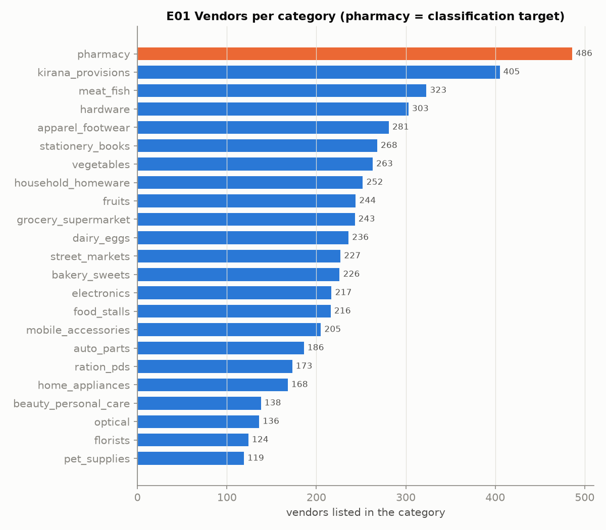

**E01 Vendors per category.** 23 categories, 5,439 memberships over 4,612 vendors. Largest
**pharmacy 486 (10.54%)**, smallest pet_supplies 119 (a 4.08× spread).
**Insight:** every category is a minority, so a one-vs-rest classifier faces **class
imbalance**. **Decision:** stratified split, and report precision/recall/F1/PR-AUC next to the
**majority baseline** (accuracy 0.8949 by always saying "no").

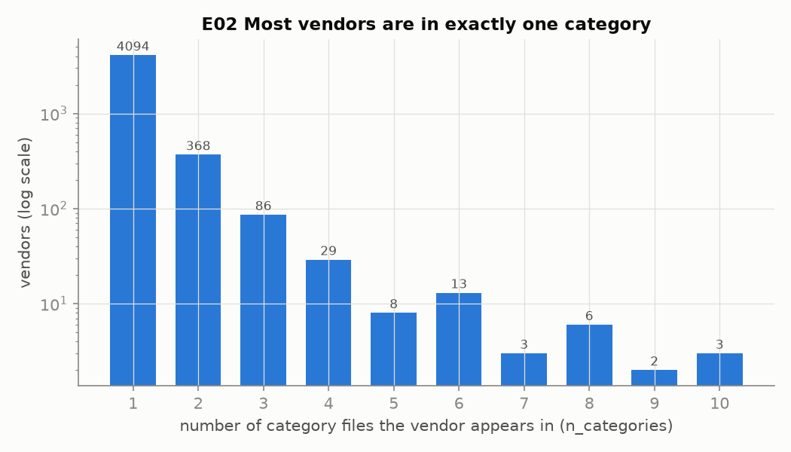

**E02 n_categories.** 88.77% of vendors are in one category; 35 vendors are in 5 or more (big
supermarkets, marketplaces). Log scale because the counts span 4,094 to 2.
**Insight:** multi-listing is rare but informative: a vendor in 10 files is either a big store
or a mislabelled one. **Decision:** keep `n_categories` as a feature. (Later its coefficient,
−3.24 per category, turned out to under-score big supermarkets, a finding in section 5.)

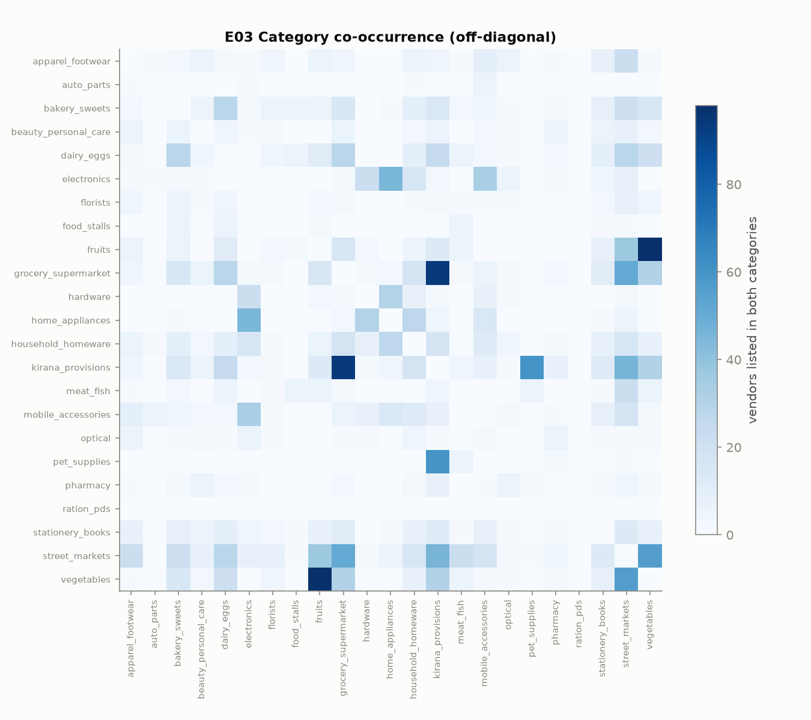

**E03 Co-occurrence.** Top pairs: fruits + vegetables 98, grocery + kirana 94, **kirana + pet
supplies 60**, street markets + vegetables 56. The ration_pds row is empty: ration shops are
never listed elsewhere.
**Insight:** overlaps are mostly real shop types, but some are **label noise** (kirana + pet).
**Decision:** treat categories as **weak labels**; trust the title when it conflicts (written
into the scoring rubric).

---

## 2.3 Geography

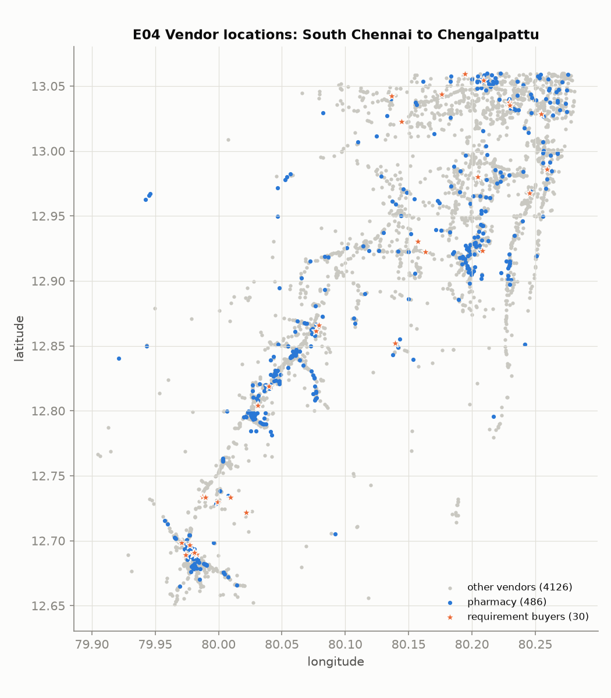

**E04 Map.** About 45.5 km × 40.8 km. 56.90% of vendors are in the northern (Chennai) half of the
box and 43.10% in the southern half. Vendors form **lines along roads** and dense clusters, with
empty space between. Pharmacies (blue) follow the same pattern; the 30 buyers (orange stars)
are spread over the whole area.
**Insight:** distance matters, but density differs by area. **Decision:** use the exact
**haversine** distance as a continuous feature *and* the 0/1 `within_radius`, because buyers
think in limits ("within 3 km").

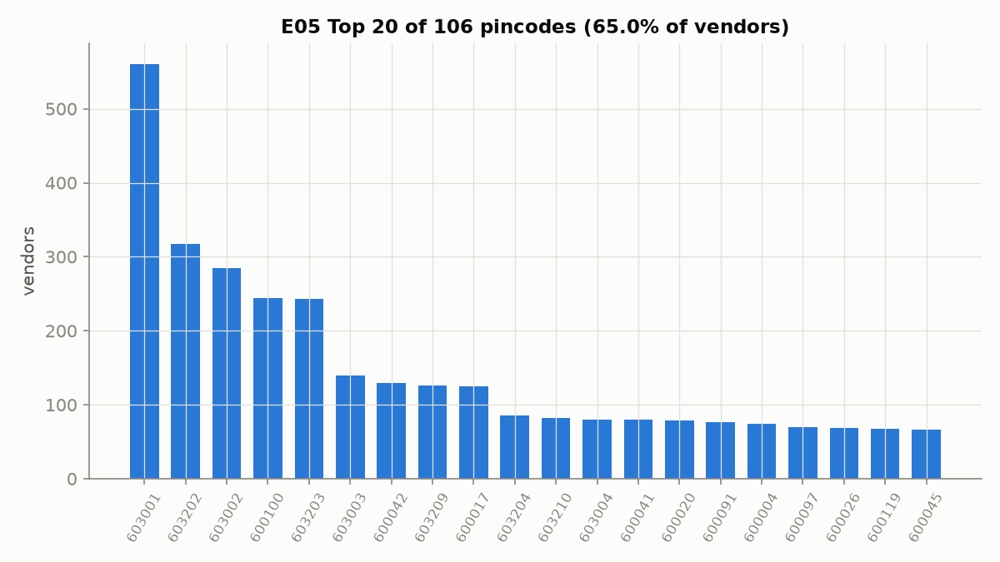

**E05 Pincodes.** 106 pincodes; the top 20 hold 64.98% of vendors; 24 pincodes have fewer than
5 vendors; the busiest (603001) has 560.
**Insight:** a long tail of rare pincodes. **Decision:** the classifier uses a **top-20 one-hot**
with all other pincodes as the all-zero reference level. Rare levels would be noise, and a full
one-hot plus intercept would be collinear (the dummy-variable trap).

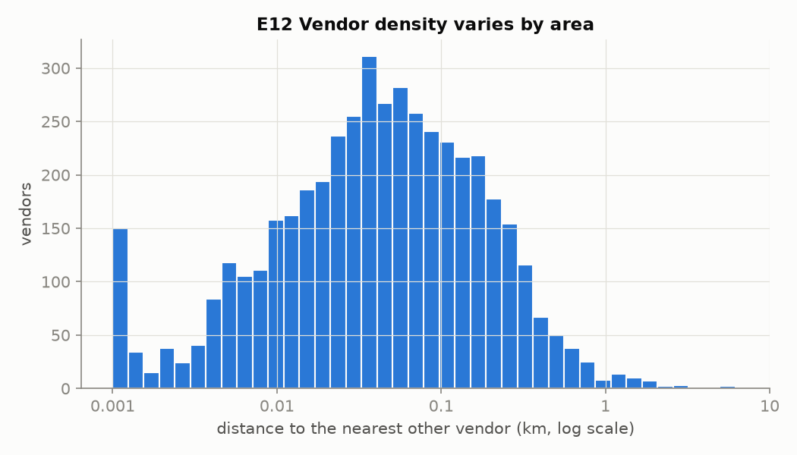

**E12 Nearest-vendor distance.** Median 0.044 km, 90th percentile 0.247 km, max 6.165 km;
821 vendors are within 10 m of another (same building or market).
**Insight:** in dense areas many candidates are at almost the same distance, so **distance alone
cannot rank them**; category and title must do the work. This is confirmed later: a
nearest-first ranking scores NDCG@5 0.874 against 0.960 for the model ranking (section 4).

---

## 2.4 Text (titles)

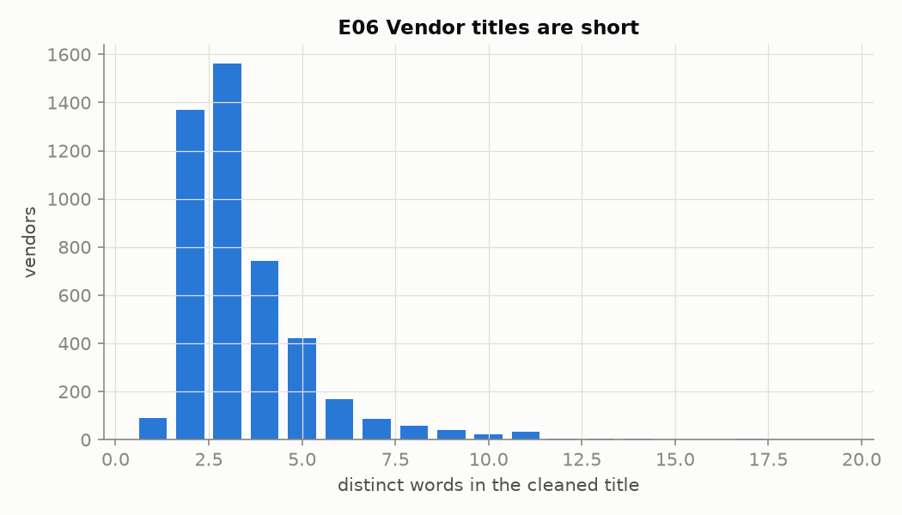

**E06 Title length.** Median 3 words (mean 3.44, max 19); 3,676 distinct words, 516 used by ≥ 5
vendors; 36 titles (0.78%) contain Tamil letters. Most common: shop 568, store 386, and 305,
sri 260, chennai 208, stores 197, market 194, pharmacy 189.
**Insight:** titles are **short and sparse**; each vendor has only a handful of words.
**Decision:** binary **word-presence** features (1 if the word is in the title), vocabulary =
words in ≥ 5 **training** titles (min_df = 5), giving 421 word columns.

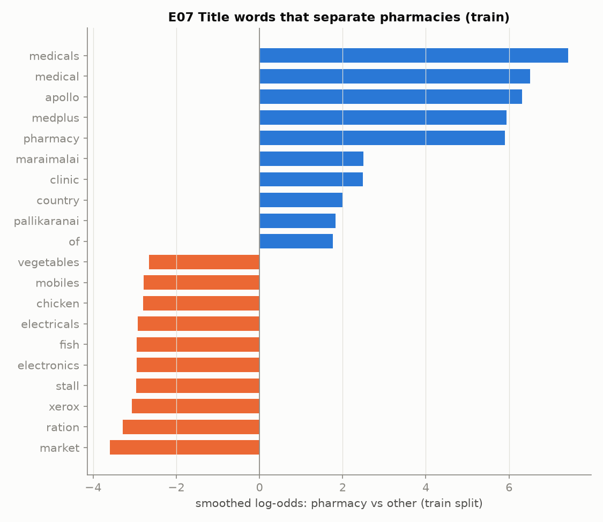

**E07 Words vs the pharmacy label (train only).** *medicals* is in 98 pharmacy titles and **0**
others; *medical* 39/0; *apollo* 32/0; *medplus* 22/0; *pharmacy* 151/3. On the other side,
*market* 0/153, *ration* 0/113, *xerox* 0/91. **116 of the 207 frequent words occur in only one
class.**
**Insight:** this is **separation**: a word that appears in only one class lets the logistic
log-likelihood keep rising as its coefficient goes to ±∞, so **the MLE does not exist**.
**Decision:** we **predicted** this from the EDA, then proved it in modelling (276 one-class
features, LP check, IRLS ‖β‖ running away), and fixed it with (a) a small model that avoids
separating words and (b) L2 regularisation (MAP). This is the strongest EDA-to-model link in the
project.

---

## 2.5 The 450 pairs and the target

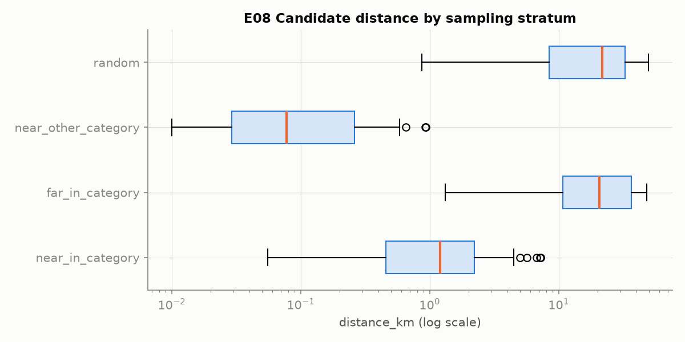

**E08 Distance by stratum.** Median distance: near_in_category 1.21 km, near_other_category
0.08 km, far_in_category 20.57 km, random 21.80 km. within_radius is 0.85 / 1.00 / 0.00 / 0.14
respectively.
**Insight:** the sampling design worked: the strata cover close/far × right/wrong category.
Only **12 of 450 pairs (2.67%)** have `keyword_in_title = 1`.
**Decision:** expect the **keyword coefficient to be the least precise** (its SE turned out to be
4.91, the largest of the six features).

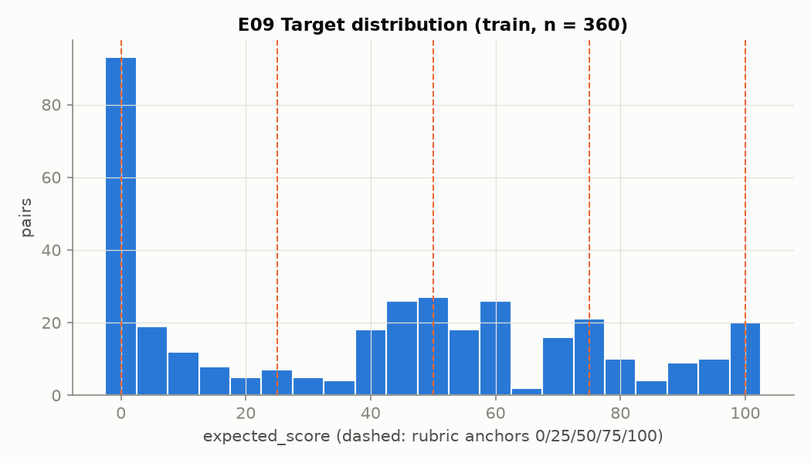

**E09 Target distribution (train, 360 pairs).** Mean 40.03, median 45, sd 33.39, range 0–100;
**41.94% of scores sit exactly on an anchor** (0/25/50/75/100); 24.72% are "relevant" (≥ 70).
**Insight:** the target is **bounded and lumpy**, not a smooth Gaussian. **Decision:** fit
Gaussian MLE anyway (it is the course method) but **check residuals** (Q-Q plot, Shapiro-Wilk)
and expect heavy tails and predictions outside 0–100 (this happened: 61 train / 14 test
predictions below 0).

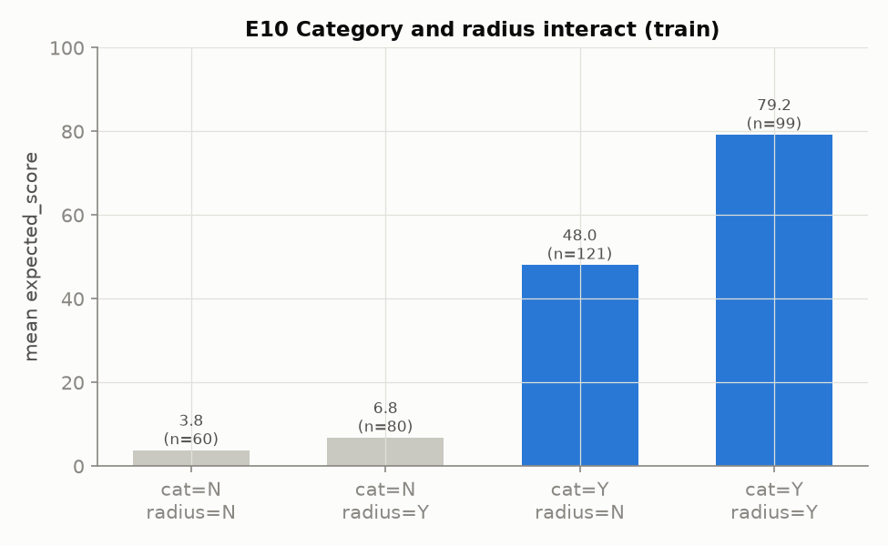

**E10 Category × radius (train).** Mean score: wrong category & outside 3.75 (n = 60); wrong &
inside 6.75 (80); right & outside 48.02 (121); **right & inside 79.16** (99).
**Insight:** being inside the radius adds **31.15** points when the category matches but only
**3.00** when it doesn't. **The effects multiply rather than add.** **Decision:** a linear
(additive) model will miss this, which motivated the **kernel** models. Kernel ridge
regression then lifted test R² from 0.751 to 0.813.

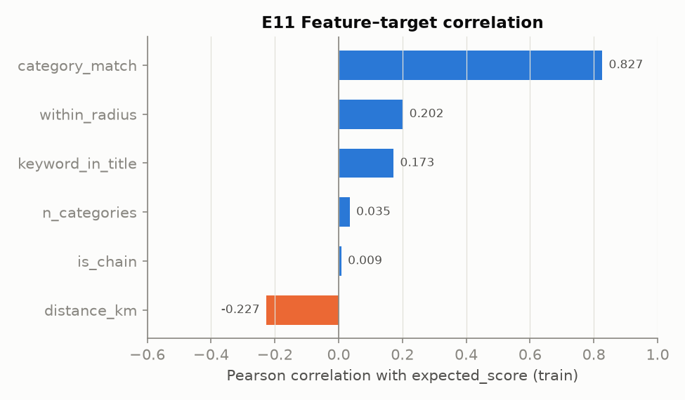

**E11 Correlations (train).** category_match **0.827**, distance −0.227, within_radius 0.202,
keyword 0.173, n_categories 0.035, is_chain 0.009.
**Insight:** one feature dominates; is_chain carries almost nothing (its coefficient later had
t = 0.87, not distinguishable from 0). Correlation is **marginal**, though: within_radius looks
weak alone (0.20) but matters a lot *given* the category (E10).

---

## 2.6 Summary: insights that drove decisions

| # | Insight | Decision it drove |
|---|---|---|
| 1 | 827 duplicate records, no conflicts | merge by id, multi-label categories |
| 2 | pharmacy = 10.5% | stratified split, F1/PR-AUC, majority baseline |
| 3 | category labels are noisy (E03) | weak labels; title wins in the rubric; label audit |
| 4 | long pincode tail (E05) | top-20 one-hot with a reference level |
| 5 | short sparse titles (E06) | binary word features, min_df = 5 on train |
| 6 | one-class words (E07) | anticipate separation → small MLE model + L2 (MAP) |
| 7 | rare keyword matches (E08) | expect an imprecise keyword coefficient |
| 8 | lumpy bounded target (E09) | check residuals; report predictions outside 0–100 |
| 9 | category × radius interaction (E10) | kernel ridge (interactions) |
| 10 | pairs share a buyer | split by requirement (GroupShuffleSplit) |

---

## Viva questions on this section

**Q1. What was the most important insight from your EDA?**
E07: many title words appear in only one class (*medicals* 98 vs 0). That predicted the
logistic MLE would not exist because of separation, and it didn't, so we used a small model
and L2.

**Q2. Why a log scale in E02 and E12?**
Counts span 4,094 to 2 (E02) and distances 0.001 to 6 km (E12). On a linear scale the small
values would be invisible.

**Q3. Correlation of within_radius is only 0.20. Is it unimportant?**
No. Correlation is marginal. E10 shows radius adds 31 points for right-category vendors and 3
for wrong ones; averaged over both, it looks weak. Its regression coefficient is +18.14 with t = 8.03.

**Q4. Why did you compute target-related EDA on the training split only?**
If test data shaped my feature or model choices, the test score would no longer be an
unbiased estimate. That would be leakage through the analyst.

**Q5. What does E09 tell you about the Gaussian assumption?**
The target is bounded at 0 and 100 and clusters at the rubric anchors (41.9%). Gaussian errors
are only an approximation, which the residual diagnostics later confirmed (excess kurtosis
2.22, Shapiro-Wilk p = 3.6e-08).

**Q6. Any data-quality problem you fixed?**
Tamil titles became empty strings with an ASCII-only cleaner, so I switched to a
Unicode-aware one; and one vendor without an address got its nearest neighbour's pincode (42 m
away), flagged as imputed.

**Q7. Is is_chain reliable?**
No. The top "chains" are "ration shop" (39) and "fair price shop" (12), which are generic names,
not chains. EDA showed it is nearly uncorrelated with the score (0.009).
