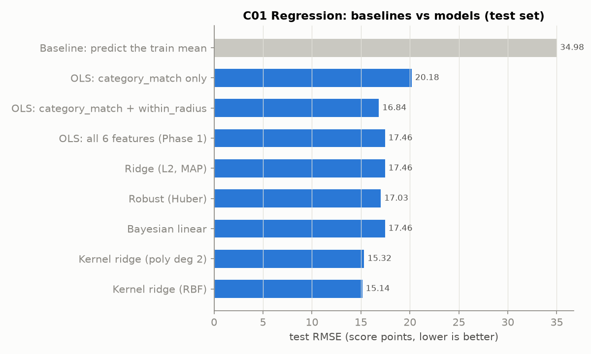
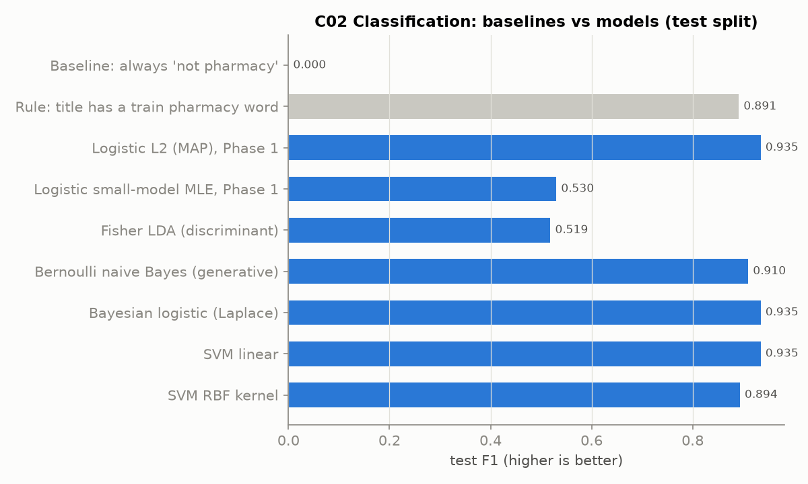

# 4. Comparative Performance Analysis (4 marks)

> What the examiner checks: is the comparison **fair** (same data, split, metric), are there
> **baselines**, do you explain **why** one model beats another, and do you know the **limits**
> of the comparison?

Numbers: [`comparison_numbers.md`](comparison_numbers.md) (regenerate with
`python src/pbl1_comparison.py`), plus graphs `07`, `09`, `10`, `13`, `17`, `19` in `graphs/`.

---

## 4.1 How the comparison was made fair

| Rule | Why |
|---|---|
| Same rows, same split, same seed (42) for every model | differences come from the model, not the data |
| Regression test = 6 **unseen requirements** (90 pairs) | measures generalisation to new buyers |
| Classification test = stratified 20% (923 vendors, 97 positives) | same class ratio as train |
| Hyperparameters by CV **on train only** | the test set is touched once, at the end |
| Baselines included | a model is only "good" relative to something trivial |
| Several metrics, chosen for the task | one number can mislead (accuracy under imbalance) |

**Metric choice.**
- *Regression:* **RMSE**, in score points, which punishes big misses; **MAE**, the typical
  miss; and **R²**, the share of variance explained, comparable across targets.
- *Classification:* **F1** and **PR-AUC**, because only 10.5% are positive; **ROC-AUC**
  measures ranking quality; **accuracy** is shown only next to the 0.8949 majority baseline.

---

## 4.2 Regression: who wins and why

| model | train R² | test R² | test RMSE | test MAE | R² gap |
|---|---|---|---|---|---|
| Baseline: predict the train mean (40.03) | 0.0000 | ≈0.0000 | 34.9835 | 30.1007 | 0 |
| OLS: category_match only | 0.6839 | 0.6671 | 20.1834 | 15.8690 | 0.0168 |
| OLS: category_match + within_radius | 0.7750 | **0.7683** | 16.8401 | 13.9889 | 0.0067 |
| OLS: all 6 features (Phase 1) | 0.7983 | 0.7510 | 17.4579 | 13.9775 | 0.0473 |
| Ridge (L2, MAP) | 0.7983 | 0.7510 | 17.4579 | 13.9775 | 0.0473 |
| Robust (Huber) | 0.7955 | 0.7630 | 17.0318 | 13.7805 | 0.0325 |
| Bayesian linear | 0.7983 | 0.7510 | 17.4578 | 13.9639 | 0.0473 |
| Kernel ridge (poly deg 2) | 0.8664 | 0.8082 | 15.3205 | 11.7256 | 0.0582 |
| **Kernel ridge (RBF)** | 0.8731 | **0.8127** | **15.1413** | **11.4336** | 0.0604 |

**Reading the table (say these points):**
1. **Every model halves the error of the baseline** (RMSE 34.98 → 15–20). The features carry
   real signal.
2. **One feature does most of the work.** category_match alone gives test R² 0.667 (E11:
   r = 0.827).
3. **Two features beat six on the test set** (0.7683 vs 0.7510). The extra four (distance,
   keyword, n_categories, is_chain) raise *train* R² (0.775 → 0.798) but not *test* R². That's a
   small amount of overfitting, and with only 6 test requirements the difference is within noise.
   Honest conclusion: the extra features don't reliably generalise.
4. **Ridge = OLS and Bayesian = OLS** (point predictions). With 6 well-conditioned features
   (κ = 114.45) and 360 rows, there is no variance to shrink; CV chose the smallest λ (0.001).
5. **Huber helps slightly** (+0.012 R²): the target has heavy-tailed errors (mislabelled
   vendors), and Huber down-weights them (121 pairs in the linear zone).
6. **Kernels win** (+0.06 R², −2.3 RMSE). The rubric is multiplicative (E10: radius is worth 31
   points with the right category, 3 without), and only the kernels model interactions. Price:
   a larger train–test gap (0.060) and less interpretability.

---

## 4.3 Classification: who wins and why

| model | accuracy | precision | recall | F1 | ROC-AUC |
|---|---|---|---|---|---|
| Baseline: always "not pharmacy" | 0.8949 | 0 | 0 | 0 | 0.5 |
| Baseline rule: title has one of {medicals, medical, apollo, medplus, pharmacy} (words from train) | 0.9794 | 1.0000 | 0.8041 | 0.8914 | — |
| **Logistic L2 (MAP)** | **0.9870** | 0.9885 | **0.8866** | **0.9348** | **0.9842** |
| Logistic small-model MLE | 0.9328 | 1.0000 | 0.3608 | 0.5303 | 0.7438 |
| Fisher LDA | 0.9296 | 0.9211 | 0.3608 | 0.5185 | 0.8786 |
| Bernoulli naive Bayes | 0.9816 | 0.9348 | 0.8866 | 0.9101 | 0.9785 |
| Bayesian logistic (Laplace) | 0.9870 | 0.9885 | 0.8866 | 0.9348 | 0.9539 |
| SVM linear | 0.9870 | 0.9885 | 0.8866 | 0.9348 | 0.9805 |
| SVM RBF | 0.9783 | 0.9231 | 0.8660 | 0.8936 | 0.9707 |

**Reading the table:**
1. **Accuracy is misleading.** Always saying "no" gets 0.8949. Compare F1 instead.
2. **A 5-word rule is a strong baseline** (F1 0.8914, precision 1.0, 78 of 97 found). L2
   logistic adds **+0.043 F1** by finding **8 more pharmacies** (recall 0.80 → 0.89) for one
   false alarm. The gain is real but modest; most of the signal is a few words.
3. **The true MLE (small model) is weak** (recall 0.36): to keep the MLE well defined it had to
   *exclude* the most predictive words (medicals, market, ration…). This is the price of
   unregularised MLE under separation.
4. **Discriminative > generative.** Logistic and linear SVM (0.9348) beat naive Bayes (0.9101)
   and LDA (0.5185). NB's independence assumption is wrong for co-occurring words, and LDA
   assumes Gaussian classes for 0/1 inputs. With 3,689 training rows, the model making fewer
   assumptions wins.
5. **L2 logistic = linear SVM = Bayesian logistic in decisions** (identical confusion
   matrices). With the same features, the regularised linear boundary is the same; they differ
   in **probabilities**. The Laplace predictive was less confident (log loss 0.0583 → 0.1065,
   ROC-AUC 0.9842 → 0.9539).
6. **A non-linear kernel doesn't help** (RBF SVM 0.8936). Word indicators are already close to
   linearly separable, and the RBF adds variance (1,155 support vectors vs 342).

---

## 4.4 Ranking comparison (prototype stage)

| ranking of 15 judged vendors × 6 test requirements | NDCG@5 | precision@5 |
|---|---|---|
| eligibility rules + model score | **0.9601** | 0.7667 |
| eligibility rules + nearest first | 0.8741 | 0.7667 |
| random (seed 42) | 0.1322 | 0.1667 |

The model score orders the eligible vendors better than distance does. Caveat: in this judged
pool the eligibility rules pick exactly the 5 "near, in-category" vendors, so precision@5 is the
same for both by construction.

---

## 4.5 Trade-offs beyond the score

| Model | Interpretability | Uncertainty | Cost | When to choose |
|---|---|---|---|---|
| OLS / Gaussian MLE | each β is "points per unit" | SEs (if assumptions hold) | closed form | explain to stakeholders |
| Huber | same as OLS | — | iterative | noisy labels/outliers |
| Bayesian linear | same + posterior | **predictive intervals** | closed form | need "74 ± 30" |
| Kernel ridge | low (dual weights) | — | O(n³) in rows | best accuracy, small n |
| Logistic L2 | log-odds per word | — | IRLS / lbfgs | default classifier |
| Naive Bayes | per-word likelihoods | — | one pass | tiny data, fast baseline |
| SVM linear | weights | — | QP | sparse (342 SVs), separable data |

---

## 4.6 Limits of this comparison (say them before the examiner does)

- **Small regression test set:** 6 requirements / 90 pairs. Differences of ~0.01–0.02 R² (OLS
  vs Huber vs 2-feature OLS) are within noise; only the kernel gain (~0.06) and the baselines
  are clear.
- **Labels:** the regression target is the rubric score from the AI judge, and the pharmacy
  label is weak. Models are compared against these labels, not against verified truth.
- **One split:** no repeated splits or confidence intervals on test metrics; CV was used only
  for tuning.
- **Rule baseline:** its 5 words were chosen from training data. A human could write a similar
  rule, which shows how much of the problem is "keyword-solvable".

---

## Viva questions on this section

**Q1. Which regression model is best, and would you deploy it?**
Kernel ridge RBF (test R² 0.8127, RMSE 15.14). For deployment I'd weigh interpretability: OLS
explains each score as a sum of feature contributions, which the prototype shows users. I'd
deploy OLS (or Huber) for transparency and keep kernels as the accuracy benchmark.

**Q2. Why did ridge not improve on OLS?**
Ridge reduces variance when features are many or correlated. Here there are 6 well-conditioned
features (κ = 114) and 360 rows, so there is little variance to reduce; CV picked λ = 0.001 ≈ 0.

**Q3. Your 2-feature model beat the 6-feature model on test. Explain.**
The four extra features improve training fit but don't generalise to these 6 requirements. It
is mild overfitting plus noise from a small test set. It suggests keyword, n_categories and
is_chain are weak or noisy predictors (is_chain t = 0.87).

**Q4. Why is accuracy not your main metric for classification?**
Only 10.5% are pharmacies; a model that always says "no" gets 89.5% accuracy with zero recall.
F1 and PR-AUC focus on the rare positive class.

**Q5. Is the ML classifier worth it over a keyword rule?**
The rule reaches F1 0.891; L2 reaches 0.935 by recovering 8 more pharmacies whose titles lack
the obvious words. Worth it, but the margin is honest and modest.

**Q6. Why do LDA and the small MLE model have the same recall (0.3608)?**
Both find only 35 of 97 pharmacies, but for different reasons: the small MLE model is restricted
to 10 common words, and LDA assumes Gaussian features for sparse 0/1 words.

**Q7. How would you make the comparison more reliable?**
Repeat the grouped split many times (or nested CV) and report mean ± sd; add more requirements;
use human-labelled scores; test differences with a paired test across requirements.
