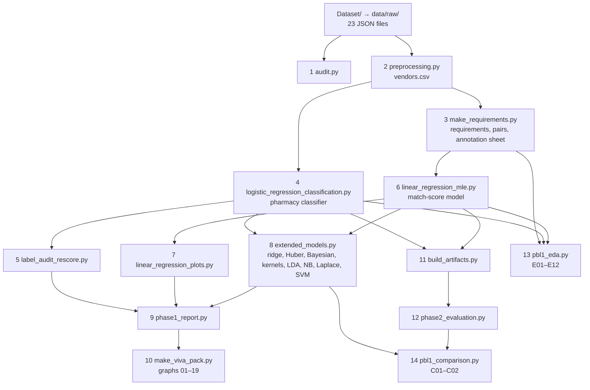

# PBL-1 viva pack: Intelligent Agent Mapping, Vendor Matching

One folder per rubric section (4 marks each, 20 in total). Each folder explains the topic in
depth, with the real numbers from this project, and ends with likely viva questions and answers.

| # | Rubric section | Folder | Key evidence |
|---|---|---|---|
| 1 | Problem Understanding & Dataset Familiarization | [01_problem_understanding](01_problem_understanding/README.md) | `reports/audit.md`, `reports/preprocessing.md` |
| 2 | Exploratory Data Analysis & Insights | [02_eda_insights](02_eda_insights/README.md) | figures E01–E12, [eda_numbers.md](02_eda_insights/eda_numbers.md) |
| 3 | Unit Topic Implementation (Regression & Classification) | [03_unit_topics_implementation](03_unit_topics_implementation/README.md) | `src/`, `notebooks/`, graphs 01–19 |
| 4 | Comparative Performance Analysis | [04_comparative_analysis](04_comparative_analysis/README.md) | figures C01–C02, [comparison_numbers.md](04_comparative_analysis/comparison_numbers.md) |
| 5 | Result Interpretation & Presentation | [05_results_interpretation_presentation](05_results_interpretation_presentation/README.md) | 10-minute talk plan, error analysis, limitations |

## The project in 60 seconds

"Buyers need local vendors. From one Google Maps snapshot (5,439 records → 4,612 vendors, 23
categories) I built 30 buyer requirements and 450 requirement–vendor pairs, scored against a
0–100 rubric. **Linear regression fitted by Gaussian MLE** predicts the match score: test R²
0.751 on unseen buyers, with category match worth +59 points. **Logistic regression** classifies
pharmacies, but its MLE does not exist because title words separate the classes, so I used a
small true-MLE model and an L2 (MAP) model with test F1 0.935. I compared ridge, Huber, Bayesian,
kernel ridge, LDA, naive Bayes, Bayesian logistic and SVMs against baselines: kernel ridge is
best for the score (R² 0.813), and discriminative models win for classification. The main
limitation is label noise."

## Project flow: the order to run the files

Run every command from the project root. Each step needs the outputs of the steps before it.



### 0. One-time setup

```powershell
python -m venv .venv
.venv\Scripts\activate
python -m pip install -r requirements.txt
```

### 1–10. Phase 1 pipeline (the models)

| Step | Command | Reads | Writes |
|---|---|---|---|
| 1 | `python src/audit.py` | `data/raw/` | `reports/audit.md` (data-quality checks) |
| 2 | `python src/preprocessing.py` | `data/raw/` | `data/processed/vendors.csv`, `reports/preprocessing.md` |
| 3 | `python src/make_requirements.py` | `vendors.csv` | `requirements.csv`, `pairs.csv`, `data/annotation/annotation_sheet.csv`, `RUBRIC.md` (an already-scored sheet is never overwritten) |
| 4 | `python src/logistic_regression_classification.py` | `vendors.csv` | `reports/classification_metrics.json`, `classification_coefficients.csv` |
| 5 | `python src/label_audit_rescore.py` | label audit sheet | `reports/label_audit_metrics.json` |
| 6 | `python src/linear_regression_mle.py` | annotation sheet + `pairs.csv` | `reports/regression_metrics.json`, `regression_coefficients.csv` |
| 7 | `python src/linear_regression_plots.py` | step 6 | `reports/figures/` (residual plots) |
| 8 | `python src/extended_models.py` | steps 4 and 6 data | `reports/extended_models_metrics.json` (about 37 s) |
| 9 | `python src/phase1_report.py` | steps 1–8 | `reports/phase1_results.md`, `reports/metrics.json` |
| 10 | `python src/make_viva_pack.py` | steps 4–8 | `graphs/01`–`19`, `viva/00_key_numbers.md` |

Steps 1–10 together took about 6.3 minutes (378 s) on the development machine.

### 11–12. Saved models and ranking evaluation (needed by the comparison in section 4)

| Step | Command | Writes |
|---|---|---|
| 11 | `python src/build_artifacts.py` | `artifacts/` (saved linear model + pharmacy classifier, model card) |
| 12 | `python src/phase2_evaluation.py` | `reports/phase2_results.md`, `reports/phase2_metrics.json` (ranking NDCG@5) |

### 13–14. This PBL-1 pack

| Step | Command | Writes |
|---|---|---|
| 13 | `python src/pbl1_eda.py` | `pbl-1/02_eda_insights/figures/E01–E12`, `eda_numbers.md` |
| 14 | `python src/pbl1_comparison.py` | `pbl-1/04_comparative_analysis/figures/C01–C02`, `comparison_numbers.md` |

Both PBL scripts write only inside `pbl-1/`. Target-related analysis uses the training split
only.

### Optional

```powershell
jupyter nbconvert --to notebook --execute --inplace notebooks/03_linear_mle.ipynb   # derivations + live numbers
jupyter nbconvert --to notebook --execute --inplace notebooks/02_logistic_mle.ipynb
python -m pytest tests -q                       # 36 tests
streamlit run app/streamlit_app.py              # prototype app (demo)
```

**If you only want to refresh this pack:** steps 1–12 have already been run and their outputs
are in the repository, so steps 13 and 14 alone are enough.

## Other material to have open in the viva

- `graphs/01`–`19`: model graphs (regression, logistic, extended models)
- `notebooks/03_linear_mle.ipynb`, `notebooks/02_logistic_mle.ipynb`: derivation next to the result
- `viva/`: earlier notes and 24 practice questions
- `reports/phase1_results.md`: the full technical record
