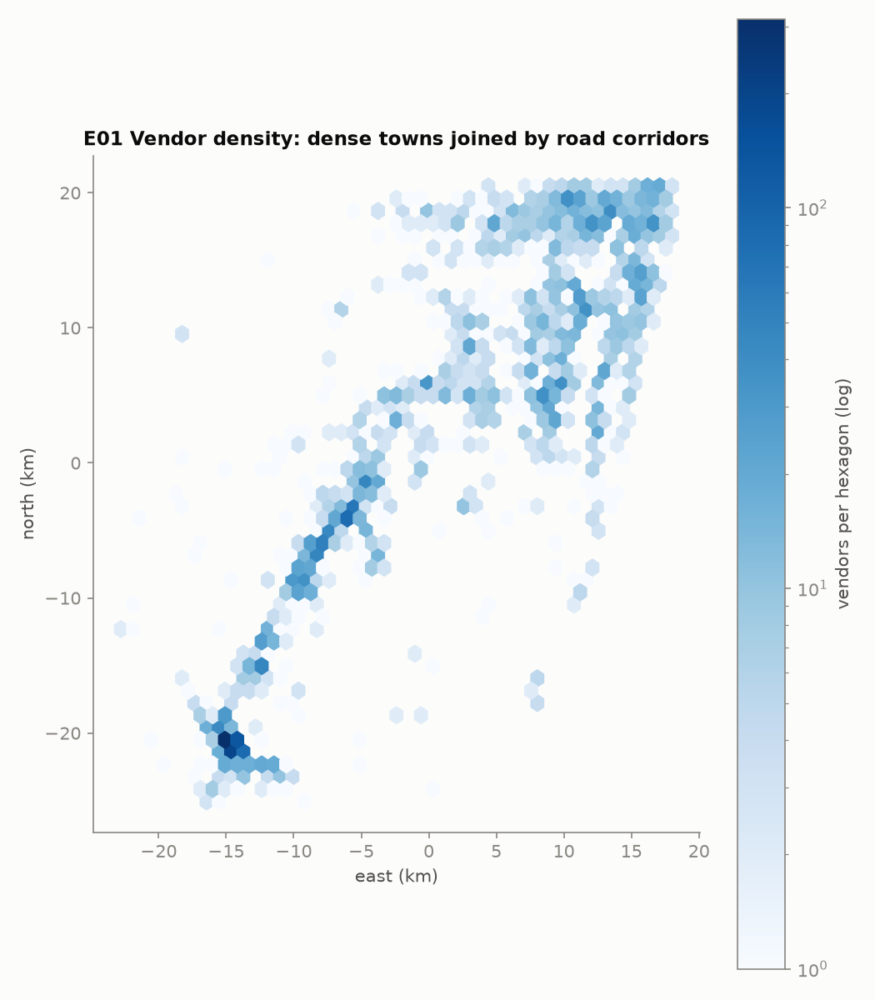
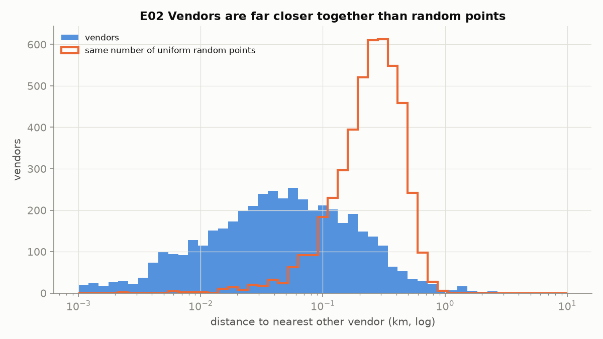
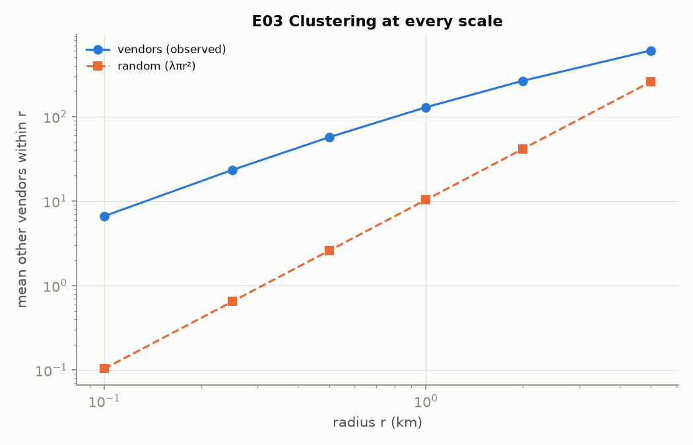
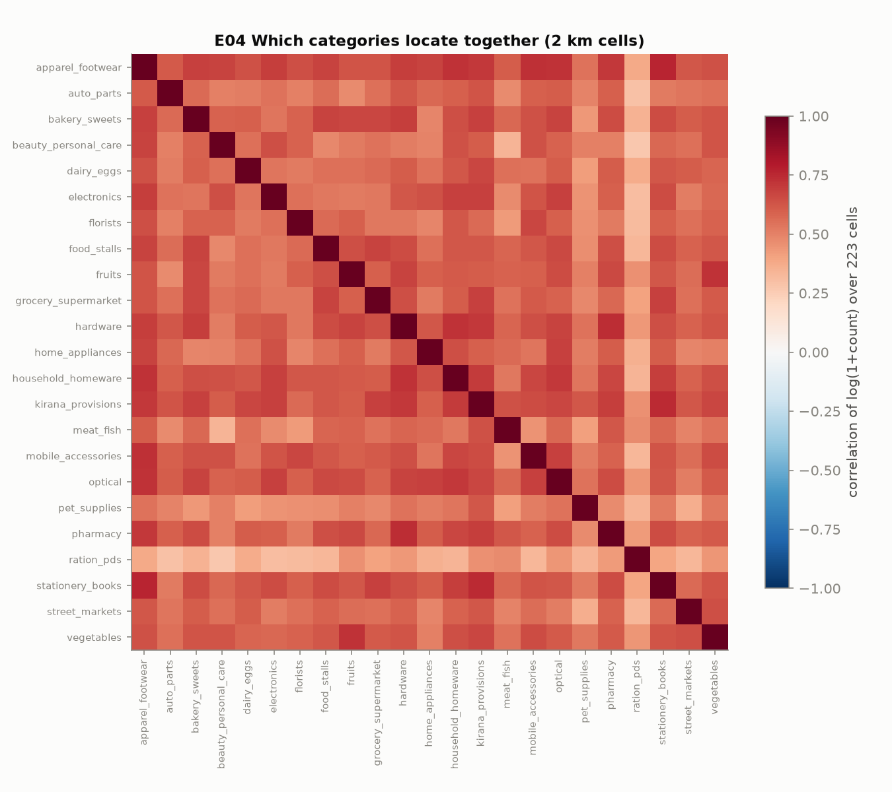
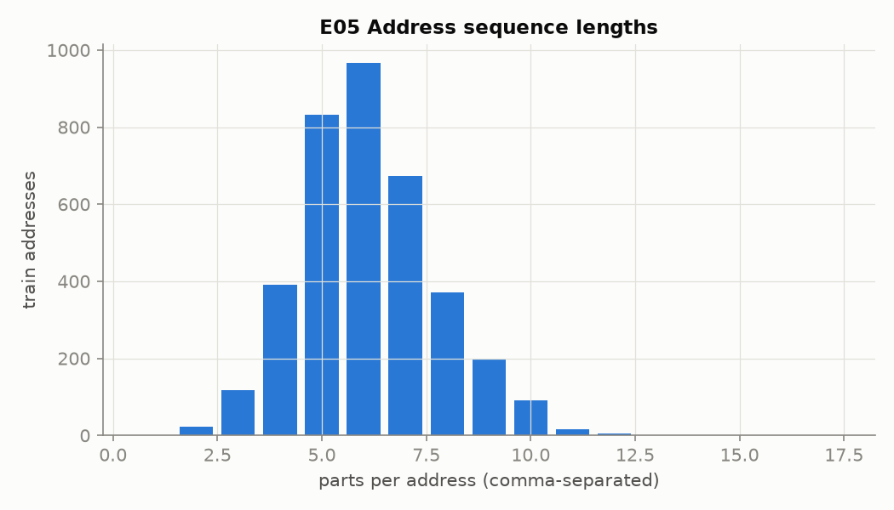
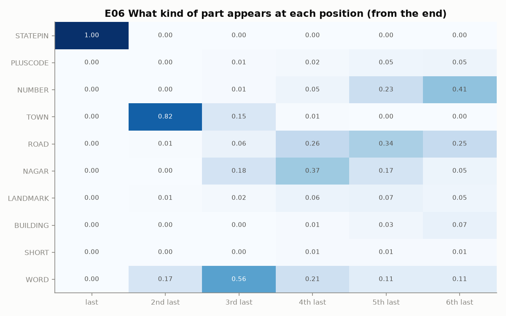
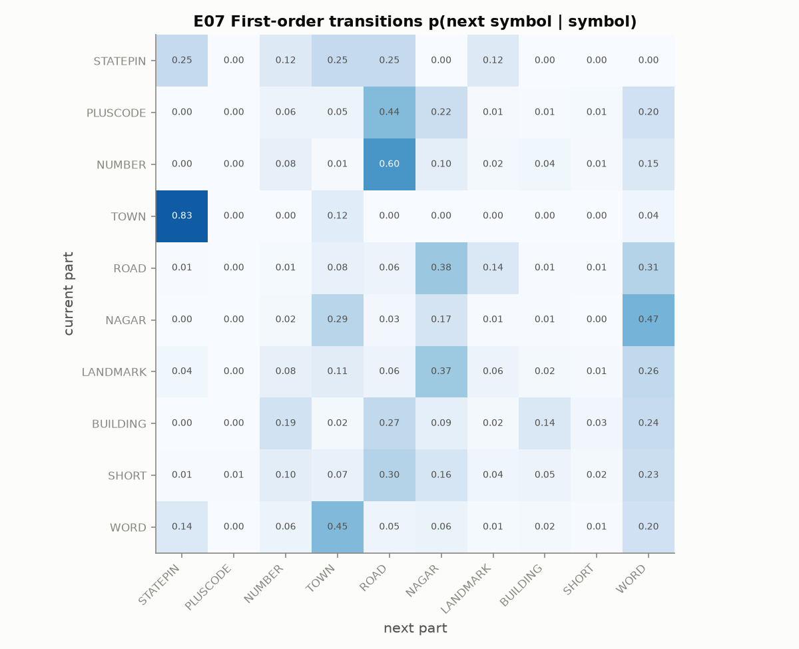

# 2. Exploratory Data Analysis & Insights (4 marks)

> What the examiner checks: did the EDA ask the questions the models need answered, and did each
> finding change a modelling decision?

All figures: `python src/pbl2_eda.py` → `figures/E01–E07`; every number below is in
[eda_numbers.md](eda_numbers.md). Address statistics use the **train** split only (the HMM's
gold set lives in the test split).

---

## 2.1 The two questions the EDA must answer

| Unit | Question before modelling | Answered by |
|---|---|---|
| III | Is there cluster structure at all, or would any clustering just cut random noise? At what scale? | E01, E02, E03 |
| III | Do categories locate together (worth a tree), and is cell size a confounder for PCA? | E04 |
| IV | Do addresses have order that a Markov model can use? How long are the sequences? | E05, E06, E07 |

---

## 2.2 E01: Vendor density

- 4,612 vendors over a convex hull of **1,399.1 km²**, i.e. 3.30 vendors per km² on average.
- The map shows **dense towns** (Chennai suburbs in the north-east, Chengalpattu in the
  south-west) **joined by road corridors** (the GST Road line).
- **Decision:** zones are elongated, not round. A Gaussian mixture with **full covariances**
  (tilted ellipses) fits this better than k-means' implicit round clusters.

## 2.3 E02: Clustering tendency (is clustering meaningful?)

| statistic | vendors | uniform random points (same count, same area) |
|---|---|---|
| median nearest-neighbour distance | **44.0 m** | 258.6 m |
| mean nearest-neighbour distance | 105.2 m | 274.8 m |
| Clark-Evans R = mean NN / CSR expectation | **0.382** | 0.998 |
| Hopkins H (mean of 20 draws, m = 300) | **0.925** (sd 0.007) | 0.500 |
| share with another vendor within 50 m | **53.5%** | 2.3% |

- **Hopkins statistic:** H = Σu / (Σu + Σw), with u = distances from random points to the
  nearest vendor and w = distances from vendors to their nearest other vendor. H ≈ 0.5 for
  random points and → 1 for clustered data. **0.925 means strongly clustered.**
- **Clark-Evans R** < 1 means clustering (1 = random, > 1 = regular spacing).
- The random reference gives H = 0.500 and R = 0.998, which confirms the method is calibrated.
- 53 vendors share exact coordinates with another vendor (same mall or building).
- **Decision:** clustering will find real structure, not artefacts.

## 2.4 E03: At what scale? (neighbours within r)

| r (km) | observed mean neighbours | random λπr² | ratio |
|---|---|---|---|
| 0.1 | 6.65 | 0.104 | **64.2×** |
| 0.5 | 57.03 | 2.589 | 22.0× |
| 1.0 | 129.12 | 10.356 | 12.5× |
| 2.0 | 265.61 | 41.425 | 6.4× |
| 5.0 | 607.03 | 258.905 | 2.3× |

- The excess over random is largest at 100 m and **never disappears**: clusters exist at street,
  neighbourhood and town scale at once.
- **Decision / prediction:** a likelihood criterion (BIC) will keep adding components as K grows,
  because every extra Gaussian can model a finer cluster. This prediction came true (§3.2: BIC
  still falls at K = 25), so I chose K by the knee of the BIC curve instead.

## 2.5 E04: Which categories locate together?

- Over 223 non-empty 2 km cells, the correlation of log(1 + count) between categories is
  **positive for every pair** (mean 0.575). Busy cells have more of everything.
- Strongest pairs: apparel–stationery 0.764, kirana–stationery 0.745, hardware–pharmacy 0.737,
  apparel–mobile 0.729, fruits–vegetables 0.725.
- Weakest pairs all involve **ration_pds** (government ration shops: 0.27–0.32). They are spread
  by population, not by commercial streets.
- **Decision:** raw counts mainly measure *how busy* a cell is (a size effect). For PCA/FA (§3.6)
  I use each cell's **shares** (fraction of its vendors in each category), standardised, so the
  components describe the *mix*, not the size.

## 2.6 E05: Address sequence lengths

- 3,688 train addresses, 22,584 parts; length median **6**, mean 6.12, min 1, max 17.
- **100%** end with the `Tamil Nadu <pincode>` part.
- **Decision:** sequences are short, so exact brute-force checks are possible for small T
  (5⁷ = 78,125 paths for T = 7). But joining all test addresses gives 5,778 symbols, long
  enough to show why scaling is needed.

## 2.7 E06: What appears at each position

| symbol | share of all parts | share at last position | share at 2nd last |
|---|---|---|---|
| STATEPIN | 16.4% | **100%** | 0.1% |
| TOWN | 16.0% | 0% | **81.5%** |
| WORD | **19.8%** | 0% | 16.8% |
| ROAD | 13.4% | 0% | 0.6% |
| NUMBER | 12.8% | 0% | 0% |
| NAGAR | 12.2% | 0% | 0.2% |

- Position matters a lot: the last part is always the state; the second last is a town 81.5% of
  the time.
- **WORD is the largest class and the most ambiguous:** it can be a shop name, a neighbourhood
  or a town. Only context separates them.
- **Decision:** an i.i.d. model (each part independent) cannot use position. A Markov / hidden
  Markov model can.

## 2.8 E07: First-order transitions

- Entropy of a part's symbol on its own: **2.943 bits**. Given the previous part's symbol:
  **1.902 bits**, a **35.4% reduction**. One step of context removes over a third of the
  uncertainty.
- STATEPIN is almost never followed by anything (0.2%), so it is effectively an end state.
- **Decision:** a first-order Markov assumption captures real structure, so an HMM with
  first-order transitions is justified. C03 confirms it on held-out data: order-1 log-likelihood
  per symbol −1.372 vs −2.043 for order 0.

---

## 2.9 Summary: EDA finding → modelling decision

| Finding | Decision |
|---|---|
| Hopkins 0.925, Clark-Evans 0.382 | clustering is meaningful |
| Zones are elongated corridors | full-covariance GMM; report k-means vs GMM |
| Clustered at every scale (64× at 100 m … 2.3× at 5 km) | expect BIC to keep falling; choose K by the knee |
| Category counts all positively correlated (size effect) | PCA on standardised shares, not counts |
| Last part = state 100%; 2nd last = town 81.5% | strong positional structure → HMM |
| Previous symbol cuts entropy by 35% | first-order Markov transitions are worth modelling |
| WORD is 19.8% and ambiguous | the HMM's value is resolving WORD by context |

---

## Viva questions on this section

**Q1. What is the Hopkins statistic and what does 0.925 mean?**
It compares nearest-neighbour distances from random locations to the data (u) with those
from data points to other data points (w): H = Σu/(Σu + Σw). If the data were random, both are
alike and H ≈ 0.5. Clustered data has small w, so H → 1. 0.925 means strongly clustered, and my
random-point control gives 0.500.

**Q2. Why sample Hopkins reference points inside the convex hull, not the bounding box?**
The bounding box includes empty land outside the study area. Random points there are far from
any vendor, which inflates u and H even for random data. My first version did this and got 0.79
for random points; sampling inside the hull gives the correct 0.50.

**Q3. Why did you predict BIC would not settle on a small K?**
E03 shows clustering at every scale. A GMM can always improve the likelihood by splitting a
town into neighbourhoods, and with 4,612 points the BIC penalty (½ ln n ≈ 4.2 per parameter) is
small compared with that gain.

**Q4. Why shares and not counts for PCA?**
Counts are dominated by how busy a cell is (every pair correlates positively, mean 0.575), so
PC1 would just be "size". Shares remove size and leave the mix.

**Q5. What does the 35% entropy reduction tell you?**
The previous part's symbol carries about 1 bit of information about the next one. That is the
information a first-order Markov chain or HMM transition matrix exploits, and an i.i.d. model
throws it away.
