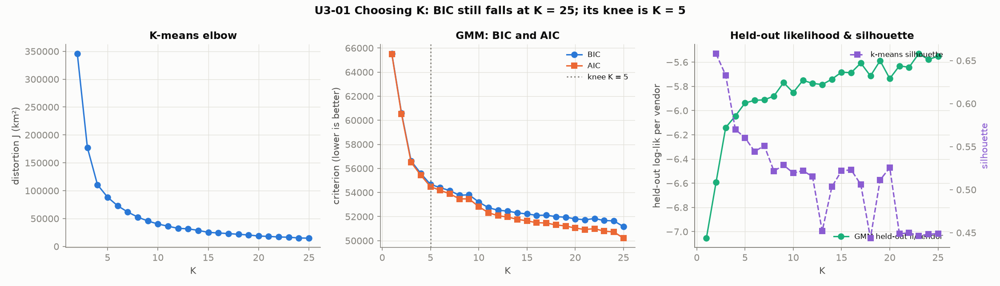
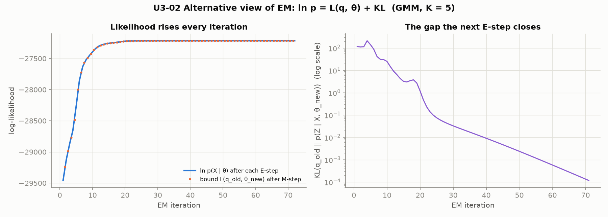
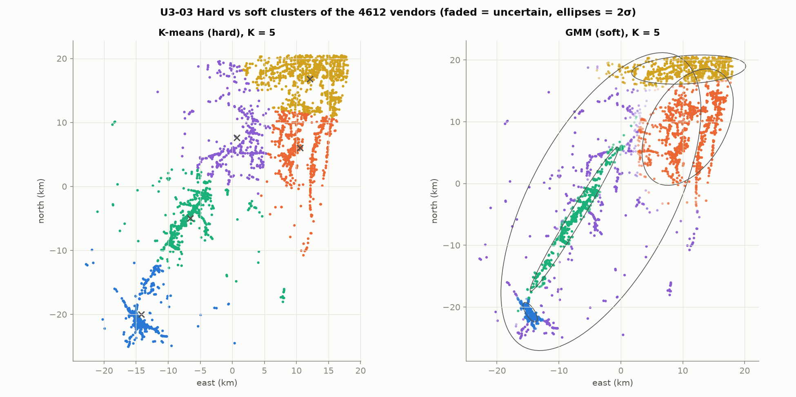
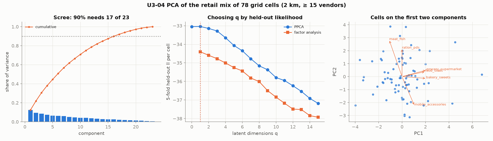
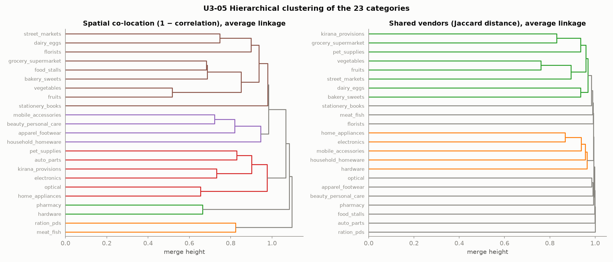
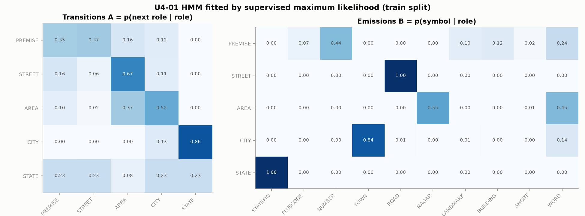
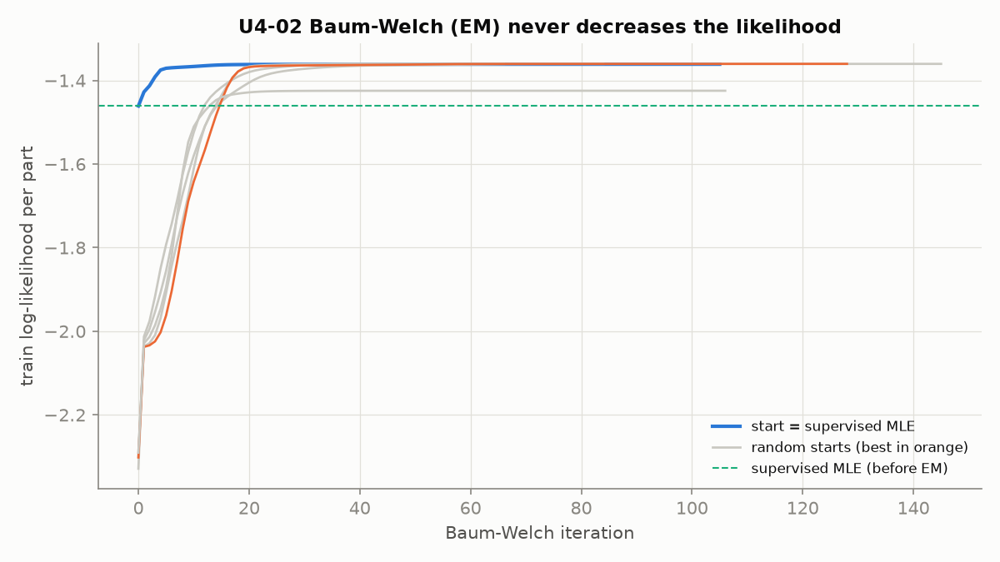
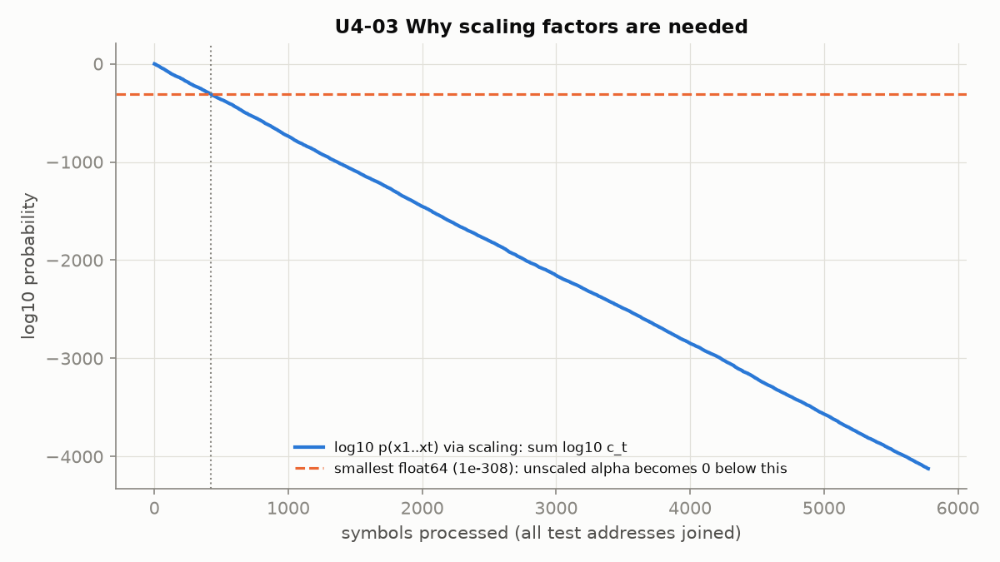
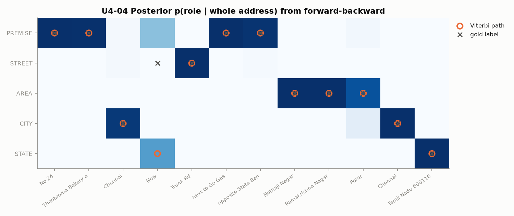
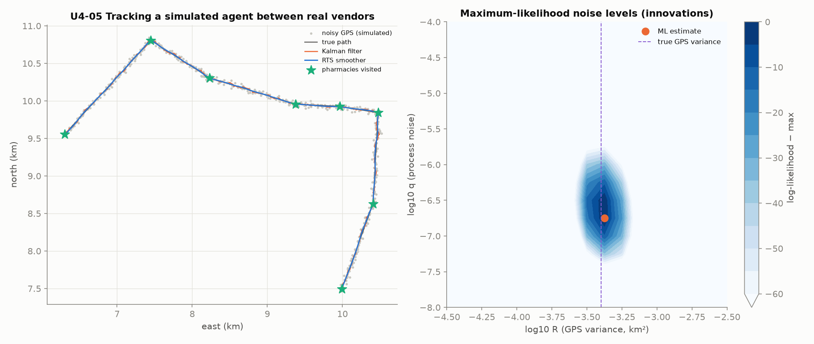

# 3. Assigned Unit Topic Implementation: Units III and IV (4 marks)

> What the examiner checks: you implemented the unit's methods **yourself** (not only called a
> library), you can derive them, and you can connect each formula to code and to a number.

**Where the code lives** (all own implementations in numpy/scipy; scikit-learn is used only to
cross-check and for factor analysis)

| Topic | File · function |
|---|---|
| K-means (k-means++ init, Lloyd) | `src/latent/clustering.py` · `kmeans_pp_init`, `kmeans` |
| Gaussian mixture by EM | `clustering.py` · `e_step`, `m_step`, `gmm_em`, `gmm_loglik`, `mvn_logpdf` |
| Alternative view of EM | `clustering.py` · `elbo`, `gmm_em(track_bound=True)` |
| BIC / AIC | `clustering.py` · `bic`, `aic`, `n_params` |
| PCA, probabilistic PCA | `src/latent/pca.py` · `pca_eig`, `ppca_params`, `ppca_loglik` |
| Markov chains, HMM | `src/latent/hmm.py` · `forward`, `backward`, `posteriors`, `viterbi`, `baum_welch`, `supervised_mle`, `brute_force`, `forward_unscaled` |
| Linear dynamical system | `src/latent/lds.py` · `constant_velocity`, `kalman_filter`, `rts_smoother` |
| Address → sequence | `src/pbl2_address.py` · `symbol`, `encode`, `town_gazetteer`, `rule_labels` |
| Experiments | `src/pbl2_unit3.py`, `src/pbl2_unit4.py` → [unit3_numbers.md](unit3_numbers.md), [unit4_numbers.md](unit4_numbers.md) |
| Correctness tests | `tests/test_latent.py` (10 tests, all pass) |

---

# Unit III: Mixture models and EM

## 3.1 K-means

**Objective (distortion).** J = Σₙ Σₖ rₙₖ ‖xₙ − μₖ‖², with rₙₖ ∈ {0, 1}.

**Lloyd's algorithm** = coordinate descent on J:
1. *Assignment* (fix μ): rₙₖ = 1 for k = argminⱼ ‖xₙ − μⱼ‖². This minimises J over r.
2. *Update* (fix r): ∂J/∂μₖ = −2 Σₙ rₙₖ(xₙ − μₖ) = 0 ⇒ μₖ = mean of the points in cluster k.

Each step cannot increase J and there are finitely many assignments, so it converges, but only
to a **local** minimum. Hence **k-means++** starts (next centre drawn with probability ∝ D(x)²)
and 10 restarts.

**On this data** (vendor locations in km, K = 5): J = **88,379.42** km² (scikit-learn: 88,386.61,
a slightly worse local optimum). Cluster sizes 1,223 / 763 / 919 / 458 / 1,249.
The test `test_kmeans_matches_sklearn_inertia` checks equality on synthetic blobs and that J never
increases.

## 3.2 Mixture of Gaussians fitted by EM

**Model.** p(x) = Σₖ πₖ N(x | μₖ, Σₖ), with a latent zₙ ∈ {1..K}, p(zₙ = k) = πₖ.

**Log-likelihood.** ln p(X | θ) = Σₙ ln Σₖ πₖ N(xₙ | μₖ, Σₖ). The log of a sum has no closed-form
maximiser, so we use EM.

**E-step** (responsibilities, Bayes' rule):
γ(zₙₖ) = πₖ N(xₙ | μₖ, Σₖ) / Σⱼ πⱼ N(xₙ | μⱼ, Σⱼ), computed in logs with log-sum-exp
(`e_step`).

**M-step** (set the derivatives of the expected complete-data log-likelihood to 0, with
Nₖ = Σₙ γ(zₙₖ)):
- μₖ = (1/Nₖ) Σₙ γ(zₙₖ) xₙ
- Σₖ = (1/Nₖ) Σₙ γ(zₙₖ)(xₙ − μₖ)(xₙ − μₖ)ᵀ + 10⁻⁶ I (the small ridge stops a component
  collapsing onto one point, where the likelihood → ∞)
- πₖ = Nₖ / N (Lagrange multiplier for Σπₖ = 1)

`mvn_logpdf` uses a Cholesky factor, ln|Σ| = 2 Σ ln Lᵢᵢ, and a triangular solve, never Σ⁻¹.

**Choosing K** (K = 1..25, best of 3 EM starts each; full table in
[unit3_numbers.md](unit3_numbers.md)):

| criterion | best K in 1..25 |
|---|---|
| BIC = −2 ln L + p ln n | **25** (still falling at the edge) |
| AIC = −2 ln L + 2p | 25 |
| held-out log-likelihood per vendor (80/20) | 23 |
| k-means silhouette (max) | 2 |
| **knee of the BIC curve (used)** | **5** |

BIC never reaches a minimum, which the EDA predicted (clustered at every scale, E03). Every
extra Gaussian buys more likelihood than its 6 parameters cost. For *market zones* we want the
coarse level, so K is chosen by the **knee** (the point farthest below the straight line from
K = 1 to K = 25): **K = 5**, BIC 54,675.3 vs 65,524.9 at K = 1.

At K = 5, own EM ln p = **−27,215.33** = scikit-learn's −27,215.33.

## 3.3 The alternative view of EM

For **any** distribution q(Z):

ln p(X | θ) = L(q, θ) + KL(q ‖ p(Z | X, θ)), where L(q, θ) = Σ_Z q(Z) ln [p(X, Z | θ) / q(Z)].

Because KL ≥ 0, L is a **lower bound** on the log-likelihood.
- **E-step:** maximise L over q with θ fixed → q = p(Z | X, θ_old), so KL = 0 and the bound
  touches ln p.
- **M-step:** maximise L over θ with q fixed. L rises, and KL becomes > 0 again because the
  posterior has moved, so ln p rises **by at least as much** as L did.
- Hence ln p(X | θ) **never decreases**.

**Measured on the data** (`gmm_em(track_bound=True)`, K = 5):

- 72 iterations; ln p(X) **−29,458.59 → −27,215.33**, never decreasing (checked in code).
- L(q_old, θ_new) after each M-step sits below ln p(X | θ_new) (orange dots under the blue line).
- The KL gap after each M-step: 117.3, 111.9, 115.1, 212.4, 143.3, … down to **1.2 × 10⁻⁴**.
  It is always ≥ 0, and the next E-step closes it.
- `test_elbo_tight_after_e_step`: L = ln p exactly right after an E-step.

**K-means is EM's limit.** With equal weights and a shared covariance εI, γ(zₙₖ) ∝
exp(−‖xₙ − μₖ‖²/2ε). As ε → 0 it becomes a hard 0/1 assignment, and the M-step becomes the
cluster mean: Lloyd's algorithm.

| ε (km²) | ARI vs k-means | mean max responsibility |
|---|---|---|
| 10 | 0.9782 | 0.9439 |
| 1 | 0.9963 | 0.9951 |
| 0.1 | 0.9973 | 0.9997 |
| 0.01 | **0.9994** | **1.0000** |

**Hard vs soft** (full-covariance GMM vs k-means, K = 5):

- ARI between the two partitions is only **0.542**: the GMM's tilted ellipses follow the road
  corridor, and one wide component (purple, weight 0.14, √det Σ = 76.9 km² against 0.3–15.7 for
  the others) absorbs the scattered vendors between towns.
- **1,138 vendors** have max responsibility < 0.9, and **220** have < 0.6. These are border
  vendors that k-means forces into one zone without saying it is unsure.

## 3.4 Clustering: measuring dissimilarity

| data | dissimilarity | why |
|---|---|---|
| locations | Euclidean on **projected km** | within **0.19%** (max) / 0.11% (mean) of haversine over 19,995 random pairs |
| locations (wrong way) | Euclidean on raw degrees | up to **2.77%** error: a degree of longitude is 108.5 km here, a degree of latitude 111.3 km |
| categories across cells | 1 − Pearson correlation of shares | "do they locate in the same places?" (scale-free) |
| categories across vendors | Jaccard distance 1 − \|A∩B\|/\|A∪B\| | "how many vendors are listed in both?" (sets, 0/1 data) |

Using degrees instead of km changes the K = 8 k-means partition only slightly (ARI 0.9947, about
13 vendors move), because the distortion is 2.8%. Near the equator it would be negligible, while
at 60° N a degree of longitude is half a degree of latitude.

## 3.5 Evaluating the output of clustering

**Internal** (no labels): silhouette s = (b − a)/max(a, b) (a = mean distance to own cluster,
b = to nearest other cluster); Davies-Bouldin (mean worst ratio of within-cluster scatter to
between-centre distance, lower is better); Calinski-Harabasz (between/within variance ratio).

**External** (labels never used in fitting): ARI (pair-counting agreement corrected for chance:
0 = random, 1 = identical) and NMI.

| K = 5 labels | ARI locality | NMI locality | ARI pincode | NMI pincode |
|---|---|---|---|---|
| k-means | **0.3901** | **0.4974** | **0.2336** | **0.5432** |
| GMM | 0.2937 | 0.4264 | 0.2140 | 0.5109 |
| random labels | 0.0000 | 0.0028 | 0.0002 | 0.0179 |

**Stability** (5 seeds, mean pairwise ARI): k-means single start 0.914 (min 0.791); GMM random
init 0.731 (min 0.552). EM from random starts lands in different local optima much more often.
This is why the main runs use k-means initialisation and 3 restarts.

## 3.6 PCA and factor analysis: the retail mix of an area

**Data.** 78 grid cells (2 × 2 km, ≥ 15 vendors, 4,018 vendors in total) × 23 features
(share of the cell's vendors in each category), standardised.

**PCA** (`pca_eig`): centre, S = XᵀX/n, eigendecompose S = UΛUᵀ, project onto the top
eigenvectors. The first PC is the direction of maximum variance (maximise uᵀSu subject to
‖u‖ = 1 ⇒ Su = λu). Own eigenvalues = scikit-learn's to **5.8 × 10⁻¹⁵**.

**Probabilistic PCA** (Tipping & Bishop): x = Wz + μ + ε, z ~ N(0, I_q), ε ~ N(0, σ²I) ⇒
x ~ N(μ, WWᵀ + σ²I). Closed-form ML: σ² = mean of the discarded eigenvalues,
W = U_q(Λ_q − σ²I)^{1/2}. This gives a **likelihood**, so q can be chosen on held-out data.
Own PPCA likelihood = scikit-learn's `PCA.score` (test).

**Factor analysis:** the same, but ε ~ N(0, Ψ) with Ψ **diagonal**: each feature has its own
noise variance. Fitted by EM (scikit-learn `FactorAnalysis`).

**Loadings** (what the components mean):
- **PC1 (12.4%)** + grocery_supermarket, bakery_sweets, food_stalls, vegetables | −
  home_appliances, pet_supplies, meat_fish, electronics → *daily-food high street vs
  durable-goods strip*
- **PC2 (9.6%)** + meat_fish, ration_pds, fruits | − mobile_accessories, household_homeware,
  electronics, beauty → *residential/basic needs vs consumer retail*
- **PC3 (8.7%)** + pharmacy, hardware | − home_appliances, optical, ration_pds

## 3.7 Choosing the number of latent dimensions

| rule | q chosen |
|---|---|
| 90% cumulative variance | **17** of 23 |
| Kaiser (eigenvalue > 1 on standardised data) | 9 |
| PPCA 5-fold held-out log-likelihood | **1** |
| FA 5-fold held-out log-likelihood | **1** |
| Minka's Bayesian evidence (scikit-learn `PCA("mle")`) | **1** |

The rules disagree wildly, and that is the lesson. The eigenvalues fall slowly (12.4%, 9.6%,
8.7%, 7.4%, 6.6%), the signature of noise rather than a few strong factors. The variance rules
keep components that **fit** this sample; the likelihood rules ask whether a component
**generalises** to held-out cells. With 78 cells and 23 features, only one direction does
(PPCA held-out ll −33.042 at q = 1 vs −33.050 at q = 0, then steadily worse). FA scores lower
than PPCA at every q (e.g. −34.40 vs −33.04 at q = 1): its 23 extra noise variances overfit 62
training cells.

## 3.8 Hierarchical clustering

Agglomerative: start with every item alone, repeatedly merge the closest two clusters. The
**linkage** defines "closest": single (min pairwise), complete (max), average (mean), Ward
(smallest increase in within-cluster variance). The result is a **dendrogram**: cut it at any
height to get any number of clusters, so no K is needed up front.

**Cophenetic correlation** (correlation between the original distances and the tree's merge
heights; higher means the tree is a more faithful summary):

| dissimilarity | single | complete | average | Ward |
|---|---|---|---|---|
| 1 − correlation of cell shares (23 categories) | 0.541 | 0.637 | **0.658** | 0.584 |
| Jaccard of vendor sets (23 categories) | 0.765 | 0.835 | **0.882** | 0.399 |

Average linkage is the most faithful for both. Ward assumes Euclidean distances, so it fits the
Jaccard distances badly (0.399).

**Five groups** (average linkage, spatial correlation):
1. meat_fish, ration_pds (basic needs, residential streets)
2. hardware, pharmacy
3. auto_parts, electronics, home_appliances, kirana_provisions, optical, pet_supplies
4. apparel_footwear, beauty_personal_care, household_homeware, mobile_accessories (consumer
   high street)
5. bakery_sweets, dairy_eggs, florists, food_stalls, fruits, grocery_supermarket,
   stationery_books, street_markets, vegetables (daily food / markets)

On points, agglomerative clustering of all 4,612 vendors with each linkage is compared with
k-means and GMM in [§4.1](../04_comparative_analysis/README.md).

---

# Unit IV: Hidden Markov models

## 3.9 Markov models of sequential data

**Order 0** (i.i.d.): p(x₁..x_T) = Π p(x_t). **Order 1** (Markov chain):
p(x₁..x_T) = p(x₁) Π p(x_t | x_{t−1}). ML estimates are normalised counts (add-one smoothed).

Held-out (923 test addresses, 5,778 parts) log-likelihood per symbol:

| model | test ll / symbol | perplexity |
|---|---|---|
| order 0 | −2.0434 | 7.72 |
| **order 1** | **−1.3719** | **3.94** |
| HMM (5 roles), supervised MLE | −1.4835 | 4.41 |
| HMM after Baum-Welch | −1.3834 | 3.99 |

Using one step of context halves the perplexity (7.72 → 3.94). The visible order-1 chain on the
10 symbols has 90 free transition parameters; the HMM squeezes the structure through 5 hidden
roles, so it is slightly worse at *predicting* symbols, but it gives **interpretable roles**,
which is what we want.

## 3.10 HMM: maximum likelihood with known states

**Model.** z₁ ~ π; z_t | z_{t−1} ~ A[z_{t−1}, ·]; x_t | z_t ~ B[z_t, ·]. K = 5 roles, M = 10
symbols.

**Joint likelihood.** p(X, Z) = π_{z₁} Π_t A_{z_{t−1}z_t} Π_t B_{z_t x_t}. With Z observed (rule
labels on the train split), ln p is a sum of separate multinomial log-likelihoods, so the MLEs
are **normalised counts**:
π̂ₖ = #(z₁ = k)/N, Â_ij = #(i→j)/#(i→·), B̂_km = #(state k emits m)/#(state k). Add-one smoothing
(a Dirichlet(2) MAP estimate) keeps unseen events possible (`supervised_mle`).

Fitted transitions (rows = current role):

| from \ to | PREMISE | STREET | AREA | CITY | STATE |
|---|---|---|---|---|---|
| PREMISE | 0.353 | 0.370 | 0.159 | 0.117 | 0.000 |
| STREET | 0.159 | 0.058 | **0.673** | 0.109 | 0.000 |
| AREA | 0.097 | 0.018 | 0.367 | **0.517** | 0.001 |
| CITY | 0.005 | 0.003 | 0.002 | 0.133 | **0.858** |
| STATE | 0.231 | 0.231 | 0.077 | 0.231 | 0.231 |

π = (0.878, 0.085, 0.029, 0.007, 0.001): 87.8% of addresses start with a PREMISE part. The
STATE row is almost uniform because STATE is nearly always last: there are only a handful of
transitions out of it, so the add-one prior dominates (see §5).

## 3.11 HMM: maximum likelihood with hidden states (Baum-Welch = EM)

When Z is unknown, maximise ln p(X) = ln Σ_Z p(X, Z). EM:
- **E-step:** γ_t(k) = p(z_t = k | X) and ξ_t(i, j) = p(z_{t−1} = i, z_t = j | X) by
  forward-backward.
- **M-step:** the same count formulas with **expected** counts: Â_ij = Σ_t ξ_t(i, j) / Σ_t Σ_j
  ξ_t(i, j), B̂_km = Σ_{t: x_t = m} γ_t(k) / Σ_t γ_t(k), π̂ = γ₁.

- From the supervised start: **106 iterations**, train ll −32,997.6 → **−30,741.7** (38 s),
  never decreasing.
- 5 random starts end at −30,723.9, −30,724.2, −30,724.2, −30,723.9, −32,175.1: **different
  local optima**. One start is stuck 1,450 nats lower.
- Unsupervised states have no names. They are matched to roles by the **Hungarian algorithm**
  (maximising agreement with the train rule labels).

## 3.12 Forward-backward, sum-product and scaling factors

**Forward:** α_t(k) = p(x₁..x_t, z_t = k) = B_{k,x_t} Σⱼ α_{t−1}(j) A_jk.
**Backward:** β_t(k) = p(x_{t+1}..x_T | z_t = k) = Σⱼ A_kj B_{j,x_{t+1}} β_{t+1}(j).
**Posteriors:** γ_t(k) = α_t(k) β_t(k) / p(X); ξ_t(i, j) ∝ α_{t−1}(i) A_ij B_{j,x_t} β_t(j).
Cost O(TK²) instead of O(K^T).

**This is the sum-product algorithm** on the chain factor graph z₁ — z₂ — … — z_T: α is the
message passed left-to-right, β right-to-left, and the marginal at each node is the product of
its incoming messages.

**Checked exactly** (`brute_force`, 5⁷ = **78,125 paths** for a 7-part gold address):
|Δ ln p(X)| = **2.3 × 10⁻¹⁴**, max |Δ marginal| = **1.6 × 10⁻¹⁴**.

**Scaling factors.** α_t is a joint probability of t observations, so it shrinks geometrically.
Define α̂_t = α_t / p(x₁..x_t) and c_t = p(x_t | x₁..x_{t−1}):
c_t α̂_t(k) = B_{k,x_t} Σⱼ α̂_{t−1}(j) A_jk, so c_t is just the normaliser at each step, and
**ln p(X) = Σ_t ln c_t**. Backward uses the same c: β̂_t = (Σⱼ A_kj B_{j,x_{t+1}} β̂_{t+1}(j)) /
c_{t+1}; then γ = α̂ β̂ directly.

All 923 test addresses joined = **5,778 symbols**. The unscaled forward pass returns exactly
**0.0**: it drops below the smallest float64 (≈ 10⁻³⁰⁸) after **424 symbols**. The scaled pass
gives log₁₀ p(X) = **−4,124.2** with c_t between 0.00042 and 0.856.

## 3.13 Viterbi (max-product) vs posterior decoding

**Viterbi:** ω_t(k) = ln B_{k,x_t} + maxⱼ [ω_{t−1}(j) + ln A_jk], keep the argmax as a
back-pointer, trace back from argmax ω_T. It finds the single most probable **path**. Same
recursion as forward with Σ → max, done in logs so no scaling is needed.
**Posterior decoding:** argmaxₖ γ_t(k) for each t separately. It maximises the expected number
of correct parts, but the path can contain impossible transitions.

Viterbi = brute-force best path on the 7-part check: **True**.

**Gold set** (60 test addresses, 371 parts, labelled by the AI judge per
`data/annotation/ADDRESS_GUIDE.md`):

| decoder | part accuracy | macro F1 | whole address exactly right |
|---|---|---|---|
| majority role | 0.2210 | 0.0724 | 0.000 |
| rules (the HMM's training labels) | 0.9137 | 0.9211 | 0.633 |
| **HMM supervised, Viterbi** | **0.9434** | **0.9430** | **0.700** |
| HMM supervised, posterior | 0.9434 | 0.9430 | 0.700 |
| HMM Baum-Welch (from supervised) | 0.8868 | 0.8920 | 0.550 |
| HMM Baum-Welch (best random start) | 0.8760 | 0.8793 | 0.483 |

Per-role F1 (Viterbi): PREMISE 0.891, STREET 0.877, AREA 0.969, CITY 0.986, STATE 0.992.

**The HMM beats the rules it learned from.** They disagree on 14 gold parts: Viterbi is right on
**12**, the rules on 1. Nearly all are neighbourhood names with no ROAD part before them
(`Porur`, `Adyar`, `Kodambakkam`, `Velachery`, `West Tambaram`, …). The rule labels them
PREMISE ("a WORD before the first road"), but the HMM weighs both neighbours. A WORD that comes
after NAGAR parts and right before the city is far more likely under AREA (AREA → CITY 0.517)
than under PREMISE (PREMISE → CITY 0.117).

## 3.14 Linear dynamical system (Kalman filter) — SIMULATED trajectory

**Model** (continuous-state HMM): z_t = F z_{t−1} + w, w ~ N(0, Q); x_t = H z_t + v,
v ~ N(0, R). State z = [x, y, vₓ, v_y] (constant velocity, dt = 2 s); x = GPS position.

| HMM | LDS |
|---|---|
| discrete state, transition matrix A | continuous state, z_t = F z_{t−1} + noise |
| forward α | **Kalman filter**: predict m⁻ = Fm, P⁻ = FPFᵀ + Q; update K = P⁻Hᵀ(HP⁻Hᵀ + R)⁻¹, m = m⁻ + K(x − Hm⁻), P = (I − KH)P⁻ |
| backward β / γ | **RTS smoother**: J = P_t Fᵀ (P⁻_{t+1})⁻¹, m̂_t = m_t + J(m̂_{t+1} − m⁻_{t+1}) |
| ln p(X) = Σ ln c_t | ln p(X) = Σ ln N(x_t \| H m⁻_t, H P⁻_t Hᵀ + R) (innovations) |
| Baum-Welch | ML for Q, R (here a grid search over the innovations likelihood) |

**Simulation:** 8 real pharmacies in a nearest-neighbour chain, 25 km/h, 20 s stop at each, GPS
every 2 s with **20 m** noise per axis; 595 steps, 7.35 km.

- **ML noise estimate:** GPS σ = **20.5 m** (true 20 m), process noise q = 1.8 × 10⁻⁷.
- Position RMSE: raw GPS **27.78 m** (= 20√2, as expected for 2-D noise), Kalman filter 15.56 m,
  **RTS smoother 8.39 m**, 5-point moving average 12.02 m.
- `test_kalman_loglik_equals_joint_gaussian`: the innovations log-likelihood equals the exact
  log-density of the stacked observations to 10⁻⁹.

---

## Viva questions on this section

**Q1. Derive the M-step for μₖ.**
Q(θ) = Σₙ Σₖ γₙₖ [ln πₖ + ln N(xₙ | μₖ, Σₖ)]. ∂/∂μₖ = Σₙ γₙₖ Σₖ⁻¹(xₙ − μₖ) = 0 ⇒
μₖ = Σₙ γₙₖ xₙ / Σₙ γₙₖ: a responsibility-weighted mean.

**Q2. Why does EM never decrease the likelihood?**
ln p = L(q, θ) + KL. The E-step sets KL = 0 (L = ln p). The M-step raises L with q fixed. Since
KL ≥ 0, the new ln p ≥ new L ≥ old L = old ln p. I measured the KL gap after every M-step: always
≥ 0, from 212 down to 1.2 × 10⁻⁴.

**Q3. Why not just maximise the GMM likelihood over K?**
The likelihood always increases with K, and can even → ∞ if a component collapses onto one point.
BIC/AIC penalise parameters, but here even BIC keeps falling up to K = 25 because the data is
clustered at every scale. So I chose the knee (K = 5) for interpretable zones, and say why.

**Q4. Why do the variance rules give q = 17 but PPCA gives q = 1?**
Variance rules measure fit on the training cells. The eigenvalues decay slowly, so 90% needs 17
components. PPCA's held-out likelihood asks whether each extra dimension models structure that
appears in new cells. With 78 cells, only the first does; the rest is sampling noise.

**Q5. What is the difference between PCA and factor analysis?**
Both are x = Wz + μ + ε. PPCA has isotropic noise σ²I (one number); FA has diagonal Ψ (one
variance per feature), so FA can explain a feature with high unique noise without bending W
towards it. FA is not rotation-invariant and is fitted by EM. Here FA scores lower (−34.40 vs
−33.04): 23 noise variances overfit 62 training cells.

**Q6. Why is scaling needed, and how does it give the likelihood?**
α_t multiplies t probabilities < 1, so it underflows: here after 424 symbols. Normalising α at
each step by c_t = p(x_t | past) keeps it O(1), and the chain rule gives p(X) = Π c_t, so
ln p(X) = Σ ln c_t.

**Q7. Viterbi vs posterior decoding: which did you use?**
Both give 0.9434 here. Viterbi gives the single most probable path (always a valid sequence);
posterior decoding picks the best role for each part independently (maximises expected correct
parts but can produce an impossible transition). For parsing a whole address I prefer Viterbi.

**Q8. Baum-Welch increased the likelihood. Why did accuracy drop (0.943 → 0.887)?**
EM maximises p(X), not agreement with *our* role definitions. It is free to reshape the hidden
states to predict symbols better (held-out ll improves −1.484 → −1.383). It blurs the clean
supervised emissions: STREET goes from emitting ROAD 100% of the time to ROAD 81% + NAGAR 13%,
and AREA starts emitting LANDMARK 9%. Each state becomes a better *predictor* of symbols and a
worse *definition* of a role. Higher likelihood ≠ more useful latent variables.

**Q9. How is the Kalman filter an HMM?**
Same graph: hidden chain, each state emits an observation. Discrete states with tables become
continuous Gaussian states with linear maps, and the sums in forward-backward become Gaussian
integrals, which stay Gaussian. So α → (m, P) of the filter and γ → the RTS smoother.
