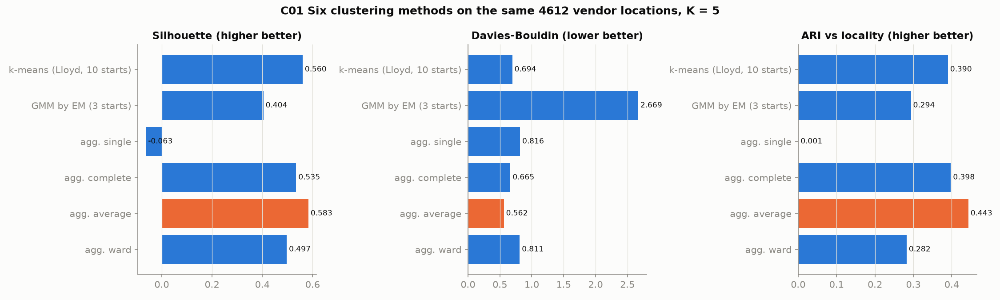
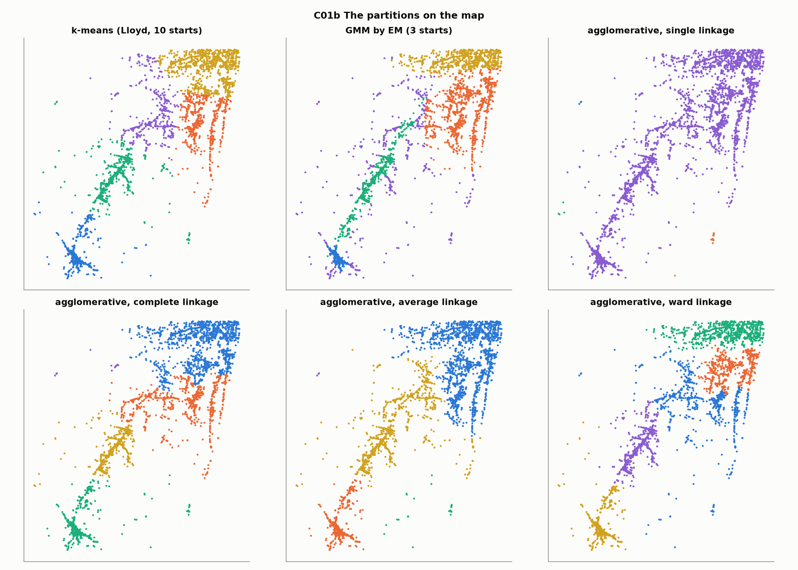
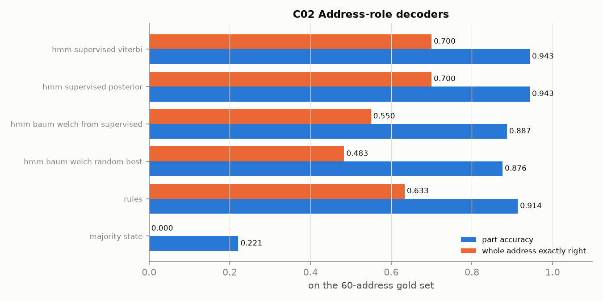
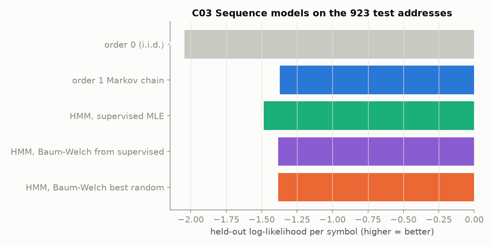
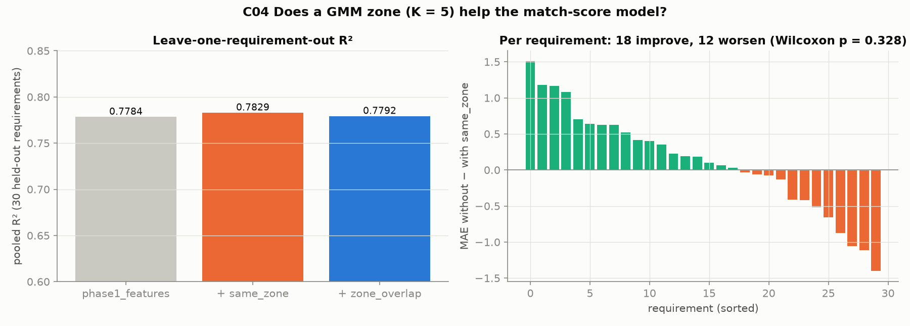
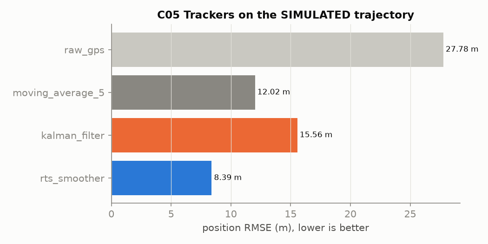

# 4. Comparative Performance Analysis (4 marks)

> What the examiner checks: were methods compared fairly (same data, same K, same split), with
> baselines, with more than one metric, and are the conclusions supported by the numbers?

All figures: `python src/pbl2_comparison.py` → `figures/C01–C05`; numbers in
[comparison_numbers.md](comparison_numbers.md).

---

## 4.1 C01: Six clustering methods on the same data

Same 4,612 vendor locations (km), same **K = 5**, same metrics.

| method | silhouette ↑ | Davies-Bouldin ↓ | Calinski-Harabasz ↑ | ARI locality ↑ | NMI locality ↑ | largest cluster | smallest cluster | time (s) |
|---|---|---|---|---|---|---|---|---|
| k-means (10 starts) | 0.560 | 0.694 | **19,187** | 0.390 | **0.497** | 27.1% | 458 | 0.87 |
| GMM by EM (3 starts) | 0.404 | 2.669 | 7,731 | 0.294 | 0.426 | 27.9% | 495 | 3.22 |
| agglomerative single | −0.063 | 0.816 | 6 | 0.001 | 0.007 | **99.6%** | **1** | 0.54 |
| agglomerative complete | 0.535 | 0.665 | 13,178 | 0.398 | 0.460 | 35.0% | 13 | 1.28 |
| agglomerative average | **0.583** | **0.562** | 8,423 | **0.443** | 0.456 | 44.2% | 3 | 1.53 |
| agglomerative Ward | 0.497 | 0.811 | 15,937 | 0.283 | 0.452 | 26.5% | 711 | 1.25 |

**Reading the table:**
- **Single linkage fails completely:** it puts 99.6% of vendors in one cluster and leaves four
  single outliers. This is the *chaining* effect: the road corridors connect everything through
  short hops, so the minimum-distance rule never separates the towns.
- **Average linkage wins on silhouette, Davies-Bouldin and ARI**, but its smallest cluster has
  3 vendors and its largest has 44%. A good score with a useless partition. **No single metric is
  enough:** look at cluster sizes too.
- **k-means is the best all-rounder:** highest Calinski-Harabasz and NMI, balanced sizes
  (458–1,249), stable across seeds (ARI 0.914), fastest.
- **GMM scores worst on the internal metrics, by design.** Silhouette and Davies-Bouldin assume
  compact, round, separated clusters. The GMM's wide background component (√det Σ = 76.9 km²)
  overlaps the others, which those metrics punish. Its value is the **soft** assignment
  (1,138 uncertain border vendors), which no hard metric rewards.
- **Ward ≈ k-means in spirit** (both minimise within-cluster variance) and gives the most
  balanced sizes (smallest 711), but greedy merging cannot undo early mistakes, so it scores
  lower than k-means.

## 4.2 C02: Address-role decoders

Scored on the 60-address (371-part) gold set from the test split:

| decoder | part accuracy | macro F1 | whole address right |
|---|---|---|---|
| majority role (baseline) | 0.2210 | 0.0724 | 0.000 |
| rules (baseline, also the training labels) | 0.9137 | 0.9211 | 0.633 |
| HMM Baum-Welch, best random start | 0.8760 | 0.8793 | 0.483 |
| HMM Baum-Welch, from supervised | 0.8868 | 0.8920 | 0.550 |
| HMM supervised, posterior decoding | **0.9434** | **0.9430** | **0.700** |
| HMM supervised, Viterbi | **0.9434** | **0.9430** | **0.700** |

- **Supervised HMM > rules > unsupervised HMM.** The HMM gains +3.0 points of part accuracy and
  +6.7 points of whole-address accuracy over its own teacher by using both neighbours.
- **Viterbi = posterior decoding here.** The posteriors are confident enough that the
  most probable part-by-part roles already form the most probable path.
- **Unsupervised EM is worse than the rules** even though it has higher likelihood (§4.3). With
  371 gold parts, a gap of 0.943 vs 0.887 is about 21 parts, which is well beyond noise.

## 4.3 C03: Sequence models, held-out likelihood

| model | test ll / symbol | perplexity |
|---|---|---|
| order 0 (i.i.d.) | −2.0434 | 7.717 |
| order 1 Markov chain | **−1.3719** | **3.943** |
| HMM, supervised MLE | −1.4835 | 4.408 |
| HMM, Baum-Welch from supervised | −1.3834 | 3.988 |
| HMM, Baum-Welch best random | −1.3830 | 3.987 |

- Context matters: order 1 halves the perplexity of order 0.
- **The ranking is the reverse of C02.** Baum-Welch HMMs predict symbols better than the
  supervised HMM (−1.383 vs −1.484) but label roles worse (0.887 vs 0.943). Likelihood and task
  accuracy are different objectives: **choose the metric that matches the use**.
- The visible order-1 chain still edges out every 5-state HMM at prediction: it has 90 transition
  parameters on 10 symbols, while the HMM must pass everything through 5 roles. An HMM earns its
  place by giving **interpretable hidden states**, not by being the best predictor.

## 4.4 C04: Does a GMM zone feature help the PBL-1 match-score model?

Two features from the K = 5 GMM: `same_zone` (buyer and vendor in the same most-likely zone) and
`zone_overlap` = Σₖ r_buyer,k · r_vendor,k (probability that both belong to the same zone).

**On the PBL-1 split** (24 train / 6 test requirements): test R² 0.7510 → **0.7632** with
same_zone, 0.7543 with zone_overlap. This looks like an improvement, but it rests on 6 test
requirements.

**Leave-one-requirement-out CV** (30 folds, every requirement held out once):

| model | pooled R² | RMSE | MAE |
|---|---|---|---|
| PBL-1 features | 0.7784 | 15.855 | 12.034 |
| + same_zone | **0.7829** | 15.692 | 11.925 |
| + zone_overlap | 0.7792 | 15.826 | 11.971 |

- same_zone lowers the MAE for 18 requirements and raises it for 12; mean gain **0.109 points**;
  **Wilcoxon signed-rank p = 0.33**.
- **Conclusion: not a significant improvement.** `same_zone` is 0.73-correlated with the existing
  `within_radius`, so it mostly repeats information the model already has. This is why one small
  split is not enough evidence.

## 4.5 C05: Trackers on the SIMULATED trajectory

| estimate | position RMSE (m) |
|---|---|
| raw GPS | 27.78 |
| 5-point moving average | 12.02 |
| Kalman filter (online) | 15.56 |
| **RTS smoother (offline)** | **8.39** |

- The smoother uses past **and future** fixes, so it beats everything: 70% less error than raw GPS.
- **The filter loses to a simple moving average.** The constant-velocity model is wrong at the 8
  stops: the agent brakes from 25 km/h to 0 instantly, so the filter overshoots past each stop.
  The moving average is centred (it uses 2 future points), so it is not a fair online
  competitor. The smoother, also offline, is the fair comparison, and it wins clearly.
- The ML noise estimate (σ = 20.5 m vs a true 20 m) shows the innovations likelihood
  identifies R well even with a mis-specified motion model.

## 4.6 C06: Rules for the number of latent dimensions

| rule | q |
|---|---|
| 90% cumulative variance | 17 |
| Kaiser (λ > 1) | 9 |
| PPCA held-out likelihood | **1** |
| FA held-out likelihood | **1** |
| Minka's Bayesian evidence | **1** |

All three probabilistic rules agree on q = 1; the two variance rules (17, 9) do not even agree
with each other. Variance rules have no notion of noise, so they cannot tell signal from
sampling variation.

---

## 4.7 Fairness of the comparisons

| Concern | What we did |
|---|---|
| Different K per method | all six clustering methods use the same K = 5 |
| Different data | same projected km coordinates for every method; same 78 cells for PCA/FA |
| Local optima | k-means 10 starts, GMM 3 starts; stability across 5 seeds reported |
| Peeking at test | town list, rule labels, HMM parameters from train only; gold ⊂ test, asserted in code |
| Small test set | the zone feature is re-checked with 30-fold CV and a paired test |
| Baselines | majority role, rules, i.i.d. model, raw GPS, moving average, random cluster labels |
| Own code vs library | k-means, GMM, PCA, PPCA, HMM and Kalman filter all checked against scikit-learn or brute force (`tests/test_latent.py`) |

---

## Viva questions on this section

**Q1. Which clustering method would you deploy for market zones?**
K-means at K = 5 for the hard zone label: balanced, stable (ARI 0.914 across seeds), best
Calinski-Harabasz and NMI, fastest. I'd add the GMM's responsibilities to flag the 1,138 border
vendors whose zone is uncertain.

**Q2. Average linkage has the best silhouette. Why not choose it?**
Its clusters have 3 and 2,040 vendors (44.2%). The metric rewards a few tiny, very separated
outlier clusters. Always look at cluster sizes and the map, not only a score.

**Q3. Why does single linkage fail here?**
Chaining: single linkage merges two clusters if *any* pair of points is close. The road
corridor is a continuous line of shops, so every town is linked to the next by short hops, and
only isolated outliers stay separate.

**Q4. The zone feature improved test R² from 0.751 to 0.763. Why don't you claim it?**
Because that was 6 test requirements. With every requirement held out once, the gain is 0.0045
R² and a paired Wilcoxon test gives p = 0.33. The feature mostly duplicates `within_radius`
(correlation 0.73).

**Q5. Why does the HMM with higher likelihood label worse?**
Baum-Welch optimises p(X). Nothing ties its hidden states to *our* role definitions, so it
reshapes them to predict symbols. When labels define the task, supervised maximum likelihood on
labelled data is the right objective.

**Q6. Is it fair that the moving average beats the Kalman filter?**
Not quite: the centred moving average uses future points, so it is offline. The fair offline
competitor is the RTS smoother (8.39 m vs 12.02 m). The filter's weakness is real, though: its
constant-velocity model is wrong at sudden stops.
