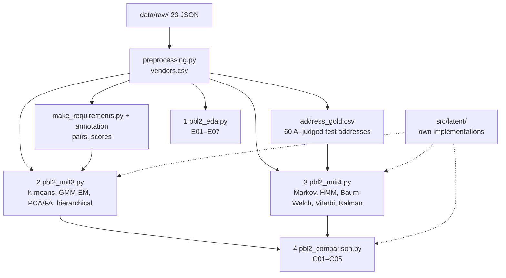

# PBL-2 viva pack: Intelligent Agent Mapping, Units III and IV

One folder per rubric section (4 marks each, 20 in total). Each folder explains the topic in
depth, with the real numbers from this project, and ends with likely viva questions and answers.
PBL-2 builds on the same data and models as [PBL-1](../pbl-1/README.md).

| # | Rubric section | Folder | Key evidence |
|---|---|---|---|
| 1 | Problem Understanding & Dataset Familiarization | [01_problem_understanding](01_problem_understanding/README.md) | what Units III/IV need from the data, and what the data can and cannot support |
| 2 | Exploratory Data Analysis & Insights | [02_eda_insights](02_eda_insights/README.md) | figures E01–E07, [eda_numbers.md](02_eda_insights/eda_numbers.md) |
| 3 | Unit Topic Implementation (Mixture Models/EM, PCA, Clustering, HMM, LDS) | [03_unit_topics_implementation](03_unit_topics_implementation/README.md) | `src/latent/`, figures U3/U4, [unit3_numbers.md](03_unit_topics_implementation/unit3_numbers.md), [unit4_numbers.md](03_unit_topics_implementation/unit4_numbers.md) |
| 4 | Comparative Performance Analysis | [04_comparative_analysis](04_comparative_analysis/README.md) | figures C01–C05, [comparison_numbers.md](04_comparative_analysis/comparison_numbers.md) |
| 5 | Result Interpretation & Presentation | [05_results_interpretation_presentation](05_results_interpretation_presentation/README.md) | 10-minute talk plan, error analysis, limitations |

## Syllabus coverage

| Unit | Topic | Where |
|---|---|---|
| III | K-means clustering | `src/latent/clustering.py` · `kmeans`; §3.1 |
| III | Mixtures of Gaussians | `clustering.py` · `gmm_em`, `e_step`, `m_step`; §3.2 |
| III | An alternative view of EM | `clustering.py` · `elbo`; figure U3_02; §3.3 |
| III | Factor analysis | `sklearn.decomposition.FactorAnalysis` vs own PPCA; §3.6 |
| III | PCA | `src/latent/pca.py` · `pca_eig`, `ppca_params`, `ppca_loglik`; §3.6 |
| III | Choosing the number of latent dimensions | scree, 90%, Kaiser, PPCA/FA cross-validated likelihood, Minka; figure U3_04; §3.7 |
| III | Clustering: measuring dissimilarity | haversine vs km vs degrees, Jaccard, correlation; §3.4 |
| III | Evaluating the output of clustering | silhouette, Davies-Bouldin, Calinski-Harabasz, ARI, NMI, stability; §3.5, C01 |
| III | Hierarchical clustering | `scipy` linkage (4 linkages), cophenetic correlation; figure U3_05, C01 |
| IV | Sequential data, Markov models | order-0 vs order-1 Markov chains on address parts; §3.9 |
| IV | HMM: maximum likelihood | supervised counts (`supervised_mle`) and Baum-Welch EM (`baum_welch`); §3.10–3.11 |
| IV | Forward and backward algorithm | `src/latent/hmm.py` · `forward`, `backward`, `posteriors`; §3.12 |
| IV | Sum-product algorithm | `posteriors` checked against brute-force enumeration of 5⁷ paths; §3.12 |
| IV | Scaling factors | `forward` keeps c_t; unscaled version underflows after 424 symbols; figure U4_03 |
| IV | Viterbi algorithm | `hmm.viterbi` (max-product); figure U4_04; §3.13 |
| IV | Linear dynamical systems | `src/latent/lds.py` · `kalman_filter`, `rts_smoother` (SIMULATED trajectory); §3.14 |

## The project in 60 seconds

"Phase 1 matched buyers to vendors with regression and classification. PBL-2 asks what hidden
structure the same 4,612 vendors contain. **Unit III:** vendors are strongly clustered (Hopkins
0.925 vs 0.500 for random points), so I wrote k-means and a Gaussian mixture fitted by EM myself
and checked them against scikit-learn. BIC never stops falling, because vendors cluster at street,
neighbourhood and town scale, so I used its knee, K = 5 market zones. The EM log-likelihood rises
every iteration, and the KL gap after each M-step is always ≥ 0. PCA of each area's retail mix
needs 17 of 23 components for 90% variance, but held-out likelihood (PPCA, FA, Minka) says
**one** latent dimension: the rest is noise. **Unit IV:** each address is a sequence of parts
whose hidden role is PREMISE/STREET/AREA/CITY/STATE. An HMM fitted by maximum likelihood decodes
94.3% of parts correctly on a held-out gold set, **beating the 91.4% rules it was trained from**,
because transitions use context. Baum-Welch raises the likelihood but lowers accuracy to 88.7%:
higher likelihood ≠ better labels. A Kalman smoother cuts simulated GPS error from 27.8 m to
8.4 m."

## Project flow: the order to run the files

Run every command from the project root. PBL-2 reads the Phase 1 outputs; it writes only to
`pbl-2/` and two JSON files in `reports/`.



### 0. One-time setup (same as PBL-1; no new packages)

```powershell
python -m venv .venv
.venv\Scripts\activate
python -m pip install -r requirements.txt
```

If `data/processed/` is missing, first run the Phase 1 steps 1–3 in
[PBL-1](../pbl-1/README.md) (`audit.py`, `preprocessing.py`,
`make_requirements.py`) and step 6 (`linear_regression_mle.py`).

### 1–4. This PBL-2 pack

| Step | Command | Reads | Writes | Time |
|---|---|---|---|---|
| 1 | `python src/pbl2_eda.py` | `vendors.csv` | `pbl-2/02_eda_insights/figures/E01–E07`, `eda_numbers.md` | ~16 s |
| 2 | `python src/pbl2_unit3.py` | `vendors.csv`, annotation sheet, `pairs.csv`, `requirements.csv` | `reports/pbl2_unit3_metrics.json`, `figures/U3_*`, `unit3_numbers.md` | ~3.5 min |
| 3 | `python src/pbl2_unit4.py` | `vendors.csv`, `data/annotation/address_gold.csv` | `reports/pbl2_unit4_metrics.json`, `figures/U4_*`, `unit4_numbers.md` | ~4 min |
| 4 | `python src/pbl2_comparison.py` | steps 2 and 3 | `pbl-2/04_comparative_analysis/figures/C01–C05`, `comparison_numbers.md` | ~30 s |

Steps 1–3 are independent; step 4 needs 2 and 3. Every number in the READMEs comes from these
files. Seed 42 everywhere, so re-running reproduces them exactly.

### Tests

```powershell
python -m pytest tests/test_latent.py -q     # 10 tests for the PBL-2 implementations
python -m pytest tests -q                    # all 46 tests
```

`tests/test_latent.py` checks: own k-means inertia = scikit-learn; own GMM log-likelihood =
scikit-learn and never decreases; the ELBO equals ln p right after an E-step; own PCA = scikit-learn;
own PPCA likelihood = scikit-learn's `PCA.score`; forward-backward and Viterbi = brute-force
enumeration; scaling prevents underflow on 3,000 symbols; Baum-Welch never decreases; supervised
HMM MLE = counts; the Kalman log-likelihood = the exact joint Gaussian density.

## New files

| File | Purpose |
|---|---|
| `src/latent/clustering.py` | k-means++, Lloyd, GMM EM, ELBO, BIC/AIC |
| `src/latent/pca.py` | PCA by eigendecomposition, PPCA closed-form ML and likelihood |
| `src/latent/hmm.py` | scaled forward/backward, posteriors (sum-product), Viterbi, Baum-Welch, supervised MLE, brute force |
| `src/latent/lds.py` | constant-velocity LDS, Kalman filter with innovations log-likelihood, RTS smoother |
| `src/pbl2_address.py` | address → part symbols, town list from train, rule-based labeller |
| `src/pbl2_style.py` | shared plot style (same palette as PBL-1), km projection, JSON writer |
| `data/annotation/address_gold.csv`, `ADDRESS_GUIDE.md` | 60 held-out addresses, 371 parts, labelled by the AI judge with a written guide |
| `tests/test_latent.py` | 10 correctness tests |

## Other material to have open in the viva

- `pbl-2/03_unit_topics_implementation/unit3_numbers.md` and `unit4_numbers.md`: every table
- `src/latent/hmm.py`: each recursion is ~10 lines and maps one-to-one to the equations
- `pbl-1/`: the Phase 1 models that the zone feature (§4.4) builds on
