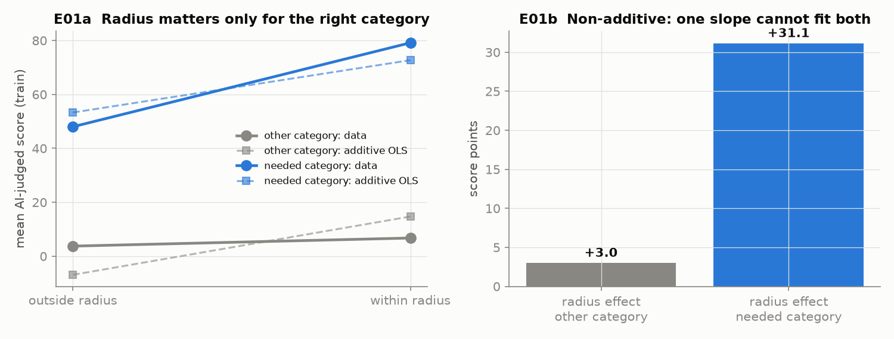
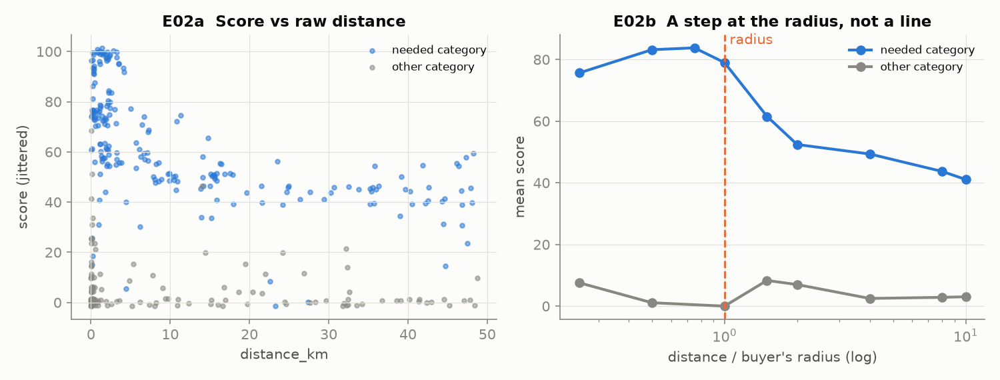
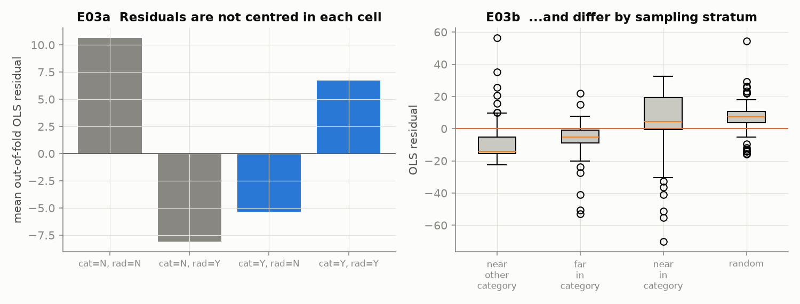
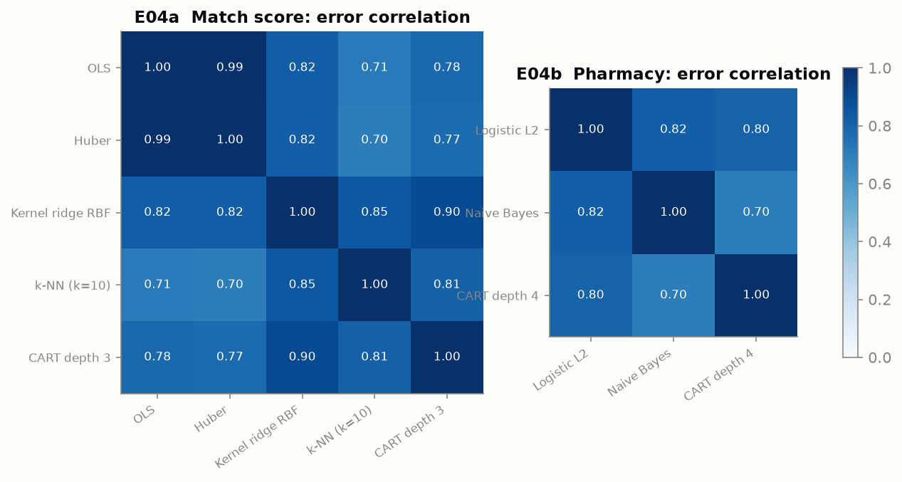
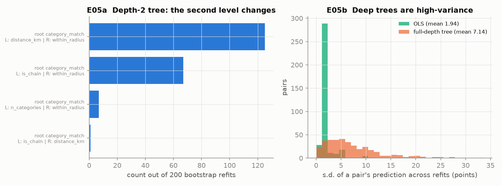
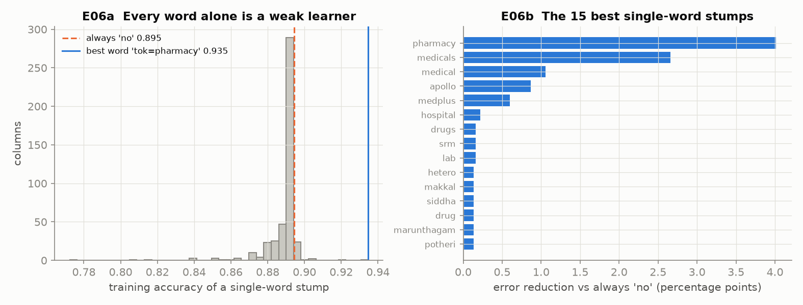
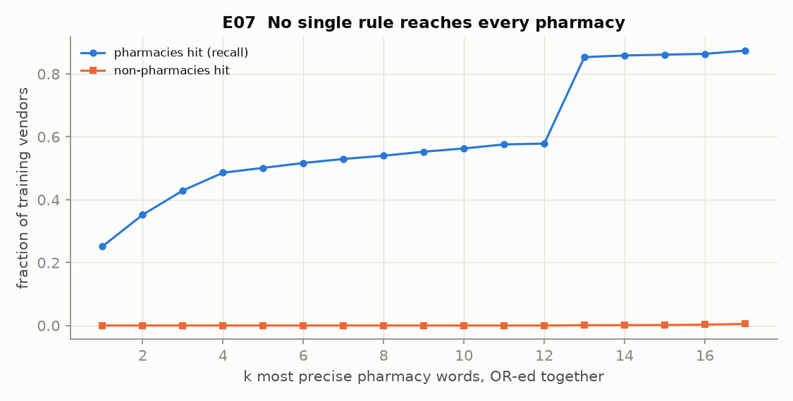
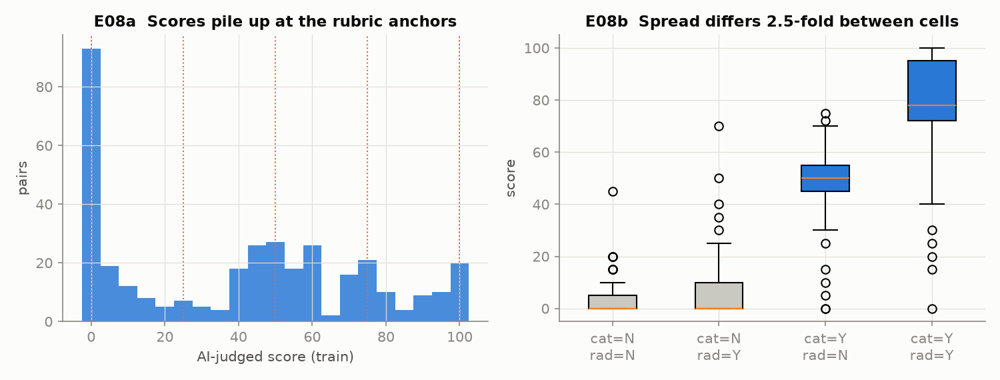

# 2. Exploratory Data Analysis & Insights (4 marks)

> What the examiner checks: did the EDA find something **specific** that drove the modelling
> choices, rather than generic histograms? Can you go from a plot to a decision?

All numbers are produced by `python src/pbl3_eda.py` and listed in
[eda_numbers.md](eda_numbers.md). **Every target-related number uses the training split only**
(360 pairs, 3,689 vendors), so the EDA cannot leak into the test results.

---

## 2.1 The questions this EDA must answer

PBL-1's EDA described the data. PBL-3's EDA asks a narrower question: **is there anything a
combination of models can gain over the PBL-1 single models?** That breaks into:

1. Is the score **non-additive** (interactions) or **non-linear** (steps, curves)? → trees, boosting, GAM (E01, E02, E03)
2. Do different model families make **different** errors? → averaging and stacking (E04)
3. Is a single tree **unstable**? → bagging, random forests (E05)
4. Are there useful **weak learners**, and does any single rule suffice? → boosting (E06, E07)
5. Is the noise **one Gaussian** or several regimes? → mixtures, robust combinations (E08)

## 2.2 E01: The radius effect depends on the category (interaction)

| category_match | within_radius | n | mean score | additive OLS mean |
|---|---|---|---|---|
| no | no | 60 | 3.75 | **−6.89** |
| no | yes | 80 | 6.75 | 14.73 |
| yes | no | 121 | 48.02 | 53.29 |
| yes | yes | 99 | 79.16 | 72.71 |

- Moving inside the radius adds **+31.15** points for the right category but only **+3.00** for
  the wrong category. The **interaction contrast** is 28.15 points.
- The additive OLS model must use one radius coefficient for both, so it splits the difference:
  it predicts **−6.89** for a far, wrong-category vendor (impossible: scores are ≥ 0) and
  under-predicts the best cell by 6.45 points.

**Decision:** use models that can represent interactions without being told: **trees** (the root
splits on category, the children on radius), **boosting with depth ≥ 2**, and a GAM **with an
explicit interaction term** (GA²M) to show what an additive model is missing.

## 2.3 E02: The score drops at the buyer's radius, not linearly in km

For the right category: mean score **79.16** inside the radius, **56.86** at 1–2× the radius,
**42.15** beyond 4×. Inside the radius the score is flat (75.65–83.77 across the four quarter
bins). The correlation of raw `distance_km` with the score is only **−0.227**.

**Decision:** the drop is a **step**, which is a tree split, plus a slow decline after it, which
is a smooth curve. Trees and boosting model the step; the GAM's spline on `distance_km` models the
curve. A straight line in km does neither well.

## 2.4 E03: Out-of-fold OLS residuals are structured

Grouped 4-fold out-of-fold residuals (each buyer predicted by a model that never saw it):

| cell (category, radius) | mean residual |
|---|---|
| no, no | **+10.62** |
| no, yes | **−8.09** |
| yes, no | −5.35 |
| yes, yes | +6.74 |

By sampling stratum the means range from −7.66 (near, other category) to +7.15 (random). If the
model were right, every group would average about 0.

**Decision:** the PBL-1 error is **bias** (wrong functional form), not only noise. Adding
**adaptive** basis functions (trees whose splits are learned) should remove it; more data would
not.

## 2.5 E04: Different model families make partly different errors

Out-of-fold errors (grouped 4-fold, training pairs):

| model | OOF RMSE |
|---|---|
| OLS | 15.36 |
| Huber | 15.32 |
| Kernel ridge (RBF) | **13.06** |
| k-NN (k = 10) | 15.13 |
| CART depth 3 | 13.95 |

- Error correlations range from **0.70** (k-NN vs Huber) to **0.99** (OLS vs Huber, the
  same model family); mean 0.82.
- The **plain average** of the five has OOF RMSE **13.44**, better than four of the five
  members but not better than the best (13.06), because three weak, highly correlated linear-ish
  members pull it toward their shared error.
- Classifier errors (pharmacy): L2 logistic vs naive Bayes 0.82, vs a depth-4 tree 0.80;
  naive Bayes vs tree **0.70**.

**Decision:** the members are diverse enough to combine, but a plain average is not enough when
members differ in quality. **Stacking** (learned weights) should do better than averaging, and
the combiners should include **different families** (linear, kernel, tree, boosting), not only
variations of one.

## 2.6 E05: One tree is unstable

200 bootstrap refits of a depth-2 tree on the 360 training pairs:

- The **root** is always `category_match` (200/200): the main effect is stable.
- The **second level changes**: left child `distance_km` 125 times, `is_chain` 67 times,
  `n_categories` 7 times. A small change in the data changes the rule a user would read.
- A full-depth tree's prediction for the same pair varies with s.d. **7.14** points across
  refits, against **1.94** for OLS (3.67×).

**Decision:** a single deep tree has low bias but high variance. This is exactly the case where
**bagging** and **random forests** help (Bishop 14.2: averaging M models divides the variance
part of the error, by up to M when the errors are uncorrelated). Single trees must be **pruned**.

## 2.7 E06: Every word on its own is a weak learner

- "Always not pharmacy" is right **89.46%** of the time (class imbalance: 10.5% pharmacies).
- The best one-word stump, "pharmacy", is right **93.47%** of the time; then "medicals" 92.11%,
  "medical" 90.51%, "apollo" 90.32%, "medplus" 90.05%.
- Only **20 of 441** single columns beat the majority rule at all. 12 words occur only in
  pharmacies; 264 only in non-pharmacies (the separation that made the PBL-1 MLE not exist).

**Decision:** stumps are textbook **weak learners**: better than chance, far from good.
**AdaBoost** re-weights the vendors each stump gets wrong so the next stump focuses on them.
That is the right tool when there are many weak rules.

## 2.8 E07: No single rule covers every pharmacy

OR-ing together the 17 words that appear in ≥ 5 training pharmacies with precision > 0.5:

- 1 word ("medicals") reaches **25.2%** of pharmacies; 5 words **50.1%**; all 17 **87.4%**,
  while hitting only 0.52% of non-pharmacies.
- The remaining **12.6%** of pharmacies have none of these words. They must be recognised from
  weaker evidence: combinations of common words, pincodes, and the *absence* of
  non-pharmacy words.

**Decision:** many rules must be combined, with **weights** (some words are more reliable than
others) and **interactions** (a word in combination with a pincode). Boosting and forests do
this automatically.

## 2.9 E08: The noise is not one Gaussian

- **41.9%** of training scores sit exactly on a rubric anchor (0/25/50/75/100) and **25.8%**
  are exactly 0.
- The score s.d. per cell ranges from **7.85** (wrong category, outside radius) to **19.77**
  (right category, inside radius): **2.5×**.

**Decision:** a single Gaussian noise level (the PBL-1 likelihood) is wrong. A **mixture of
regressions** or **mixture of experts** can give each regime its own line and its own noise
level, which should improve the held-out **likelihood** even if the mean prediction does not
change much. The many exact zeros force a **variance floor** in EM.

## 2.10 Summary: EDA finding → modelling decision

| Finding (train only) | Number | Decision |
|---|---|---|
| E01 interaction | radius +31.1 vs +3.0 points | trees; boosting depth ≥ 2; GA²M interaction term |
| E02 step at radius | 79.2 → 56.9 just outside | tree splits for the step, splines for the tail |
| E03 structured residuals | cell means +10.6 / −8.1 / −5.4 / +6.7 | the error is bias: use adaptive basis functions |
| E04 error diversity | correlations 0.70–0.99, plain average 13.44 vs best 13.06 | stacking with learned weights across families |
| E05 tree instability | prediction s.d. 7.14 vs 1.94 (OLS) | bagging / random forest; prune single trees |
| E06 weak learners | best stump 93.5% vs 89.5% baseline | AdaBoost with stumps |
| E07 coverage | 17 words reach 87.4% of pharmacies | combine many weighted rules |
| E08 several regimes | s.d. 7.9–19.8 by cell; 25.8% zeros | mixture of regressions / experts, variance floor |

---

## Viva questions on this section

**Q1. Your EDA uses an OLS model. Isn't that modelling, not EDA?**
It is diagnostic EDA: the question is whether the PBL-1 model's errors have structure. I used
out-of-fold residuals (each buyer predicted by a model that never saw it), on the training split
only. Structured residuals (E03) are what justify trying more flexible, combined models.

**Q2. What is an interaction, in one sentence, with your numbers?**
The effect of one input depends on another: being inside the radius is worth +31 points for the
right shop type but +3 for the wrong one (E01).

**Q3. Why does E05 matter for Unit V?**
It shows the variance problem that bagging solves. The same tree refitted on slightly different
data gives predictions that differ by about 7 points. Averaging many such trees keeps their low
bias and removes much of that variance.

**Q4. If the best word gives 93.5% and "always no" gives 89.5%, is the word useful?**
Alone, only a little: it is a weak learner. But boosting needs exactly that: each stump only has
to beat 50% **weighted** error. Combined with re-weighting, hundreds of such stumps make a strong
classifier (§3.9).

**Q5. Why does a high error correlation (0.82 on average) limit what averaging can achieve?**
For M models with equal error variance σ² and average correlation ρ, the variance of the average
is ρσ² + (1 − ρ)σ²/M. With ρ = 0.82, even infinitely many models only cut it to 82% of σ². The
gain comes from the (1 − ρ) part, which is why diverse families matter.

**Q6. Why is a variance floor needed in the mixture model?**
25.8% of training scores are exactly 0. EM could put one component on those points with
variance → 0, and the likelihood → ∞ (a degenerate maximum, as for Gaussian mixtures in PBL-2).
Scores are integers, so a residual s.d. below 1 point is not meaningful.
