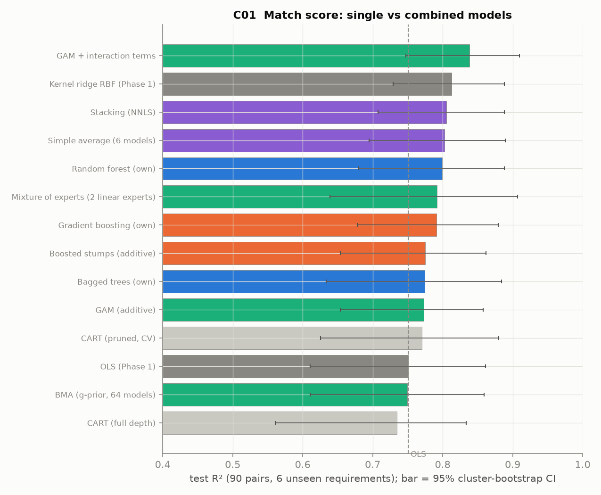
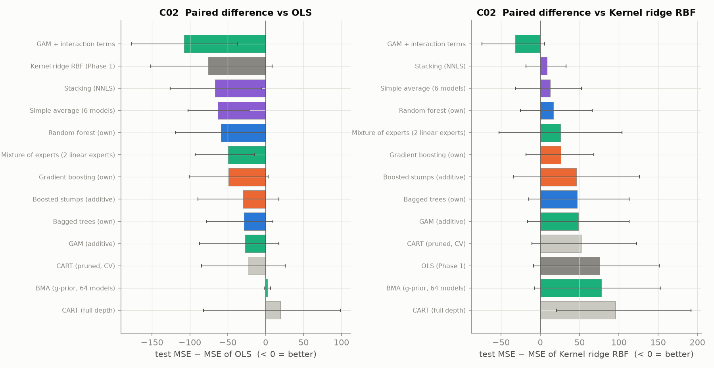
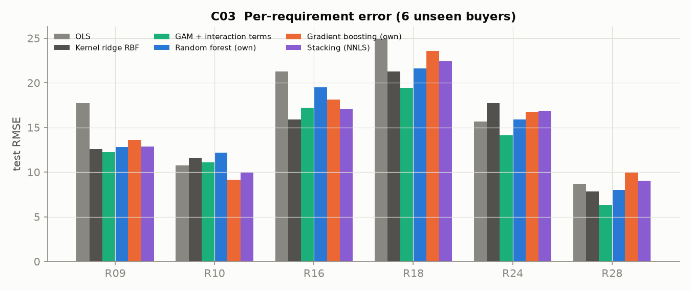
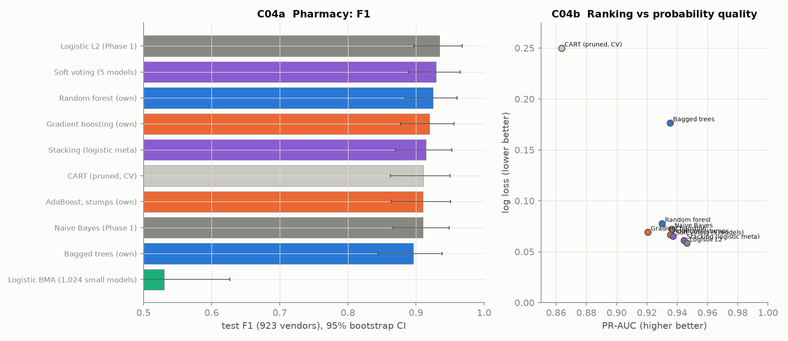
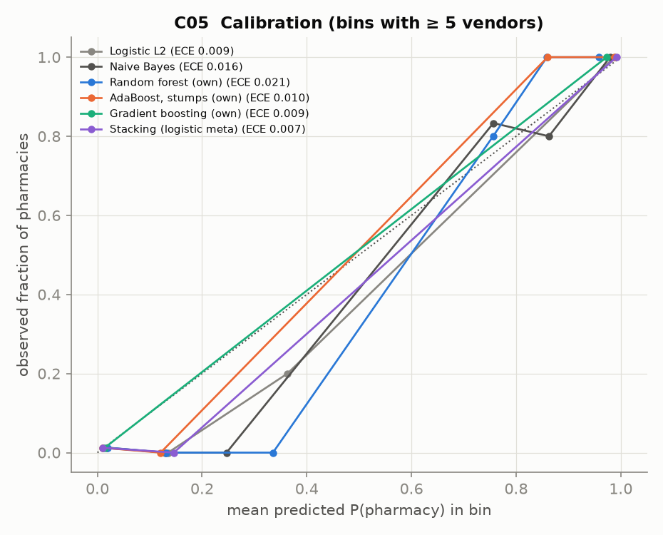
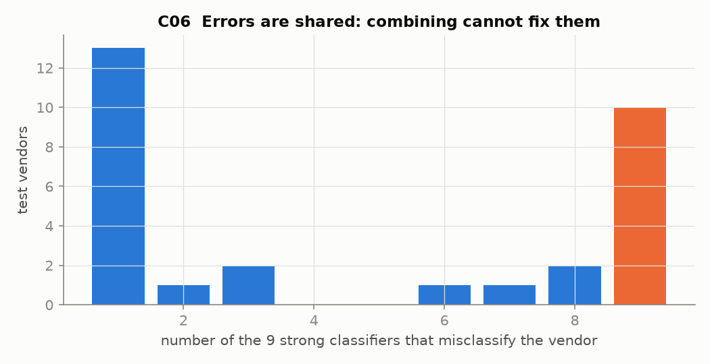

# 4. Comparative Performance Analysis (4 marks)

> What the examiner checks: are the models compared **fairly** (same data, same splits, tuned the
> same way), with a baseline, with **uncertainty**, and do you say *why* one model beats another
> rather than only *that* it does?

All numbers come from `python src/pbl3_comparison.py` →
[comparison_numbers.md](comparison_numbers.md), computed from the saved test predictions of
`src/pbl3_unit5.py`. Colours in the figures: grey = PBL-1 single models, light = single tree,
blue = committees, orange = boosting, green = additive / Bayesian / mixture, purple = learned
combinations.

---

## 4.1 C01: Match score, every model on the same 90 test pairs

95% intervals come from resampling the **6 test requirements** with replacement (2,000 times),
because pairs of one buyer are not independent.

| model | test R² | 95% CI | RMSE |
|---|---|---|---|
| **GAM + 2 interaction terms (GA²M)** | **0.8387** | [0.747, 0.910] | **14.05** |
| Kernel ridge RBF (PBL-1 best) | 0.8127 | [0.729, 0.888] | 15.14 |
| Stacking (NNLS) | 0.8056 | [0.708, 0.888] | 15.42 |
| Simple average of 6 models | 0.8025 | [0.695, 0.889] | 15.55 |
| Random forest | 0.7991 | [0.680, 0.888] | 15.68 |
| Mixture of 2 linear experts | 0.7916 | [0.639, 0.907] | 15.97 |
| Gradient boosting (depth 3) | 0.7910 | [0.678, 0.879] | 15.99 |
| Boosted stumps (additive) | 0.7751 | [0.654, 0.862] | 16.59 |
| Bagged trees | 0.7742 | [0.634, 0.884] | 16.63 |
| GAM (additive) | 0.7731 | [0.654, 0.858] | 16.67 |
| CART pruned (4 leaves) | 0.7700 | [0.626, 0.880] | 16.78 |
| OLS (PBL-1) | 0.7510 | [0.611, 0.861] | 17.46 |
| BMA over 64 linear models | 0.7492 | [0.611, 0.859] | 17.52 |
| CART full depth | 0.7348 | [0.561, 0.834] | 18.01 |

**Reading it:** the intervals are wide (about ±0.1) because there are only 6 test buyers, and
they overlap for almost every pair of models. Absolute R² alone cannot separate them, so §4.2
compares models **on the same pairs**.

## 4.2 C02: Paired differences, the fair test

ΔMSE = MSE(model) − MSE(baseline) on the same test pairs, with a cluster-bootstrap 95% CI.
Pairing removes the "this buyer is hard for everyone" variation, so intervals shrink a lot.

**Against OLS (PBL-1):**

| model | ΔMSE | 95% CI | P(better) | verdict |
|---|---|---|---|---|
| GA²M | **−107.3** | [−177.2, −36.9] | 1.000 | clearly better |
| Simple average | −63.1 | [−102.3, −21.5] | 1.000 | clearly better |
| Mixture of experts | −49.7 | [−92.9, −14.5] | 1.000 | clearly better |
| Stacking (NNLS) | −66.9 | [−126.0, −4.8] | 0.983 | better |
| Random forest | −58.9 | [−119.3, −0.3] | 0.976 | better (just) |
| Kernel ridge RBF | −75.5 | [−151.7, +8.4] | 0.960 | probably better |
| Gradient boosting | −49.0 | [−100.6, +3.3] | 0.966 | probably better |
| Bagged trees / boosted stumps / additive GAM / pruned CART | −23 to −30 | include 0 | 0.77–0.90 | not clear |
| BMA | **+2.2** | [−2.0, +6.4] | 0.161 | **no difference** (the same family as OLS) |
| CART full depth | +19.7 | [−82.0, +98.5] | 0.332 | not clear, if anything worse |

**Against kernel ridge RBF (the strongest PBL-1 model):**

| model | ΔMSE | 95% CI | P(better) |
|---|---|---|---|
| **GA²M** | **−31.8** | [−74.2, +5.7] | **0.944** |
| Stacking (NNLS) | +8.6 | [−18.0, +33.0] | 0.254 |
| Simple average | +12.4 | [−31.3, +52.7] | 0.279 |
| Random forest | +16.6 | [−25.3, +66.0] | 0.275 |
| Gradient boosting | +26.5 | [−18.4, +68.0] | 0.139 |
| CART full depth | +95.3 | [+20.7, +191.6] | 0.002 (clearly worse) |

**Verdict.**
1. **Every model that can represent the category × radius interaction beats OLS**: GA²M,
   the forest, stacking, the mixture of experts, kernel ridge, boosting. Models that cannot
   represent it, or that overfit, do not clearly beat it: additive GAM, boosted stumps, BMA, a
   full tree. That is the EDA's E01 finding confirmed on unseen buyers.
2. **None of the tree ensembles beats kernel ridge.** With 6 smooth-ish inputs and 360 rows,
   an RBF kernel already captures the interaction, and averaging trees adds no further accuracy.
3. **Only GA²M is probably better than kernel ridge** (P = 0.94; the CI just includes 0). It
   is also the most interpretable model in the table.

## 4.3 C03: Per-requirement errors (does the winner win everywhere?)

| requirement | OLS | kernel RBF | GA²M | random forest | grad. boosting | stacking |
|---|---|---|---|---|---|---|
| R09 | 17.72 | 12.56 | **12.24** | 12.82 | 13.61 | 12.89 |
| R10 | 10.74 | 11.62 | 11.09 | 12.17 | **9.18** | 9.99 |
| R16 | 21.29 | **15.92** | 17.18 | 19.47 | 18.14 | 17.11 |
| R18 | 25.02 | 21.28 | **19.42** | 21.59 | 23.56 | 22.41 |
| R24 | 15.64 | 17.75 | **14.14** | 15.92 | 16.77 | 16.85 |
| R28 | 8.67 | 7.85 | **6.28** | 8.02 | 9.98 | 9.06 |

GA²M has the lowest RMSE on **4 of 6** buyers, gradient boosting on 1, kernel ridge on 1. OLS is
never best. R18 is hard for every model (RMSE ≥ 19): its scores depend on things the six features
do not measure (see §5.4).

## 4.4 C04: Pharmacy classifier, every model on the same 923 test vendors

F1 at threshold 0.5 with a 95% bootstrap CI (1,000 vendor resamples). The **exact McNemar test**
compares each model with PBL-1's L2 logistic on the vendors where exactly one of the two is wrong.

| model | F1 | 95% CI | PR-AUC | log loss | FP/FN | McNemar vs L2: worse-only / better-only, p |
|---|---|---|---|---|---|---|
| **Logistic L2 (PBL-1)** | **0.9348** | [0.897, 0.968] | **0.9465** | **0.0583** | 1/11 | – |
| Soft voting (5 models) | 0.9297 | [0.889, 0.965] | 0.9374 | 0.0651 | 2/11 | 1 / 0, p = 1.00 |
| Random forest | 0.9247 | [0.885, 0.960] | 0.9301 | 0.0775 | 3/11 | 2 / 0, p = 0.50 |
| Gradient boosting | 0.9198 | [0.877, 0.956] | 0.9207 | 0.0690 | 4/11 | 3 / 0, p = 0.25 |
| Stacking (logistic meta) | 0.9149 | [0.870, 0.953] | 0.9446 | 0.0610 | 5/11 | 4 / 0, p = 0.13 |
| CART pruned (36 leaves) | 0.9110 | [0.863, 0.950] | 0.8638 | 0.2497 | 7/10 | 6 / 1, p = 0.13 |
| AdaBoost (stumps) | 0.9101 | [0.864, 0.951] | 0.9356 | 0.0665 | **0**/16 | 5 / 1, p = 0.22 |
| Naive Bayes (PBL-1) | 0.9101 | [0.866, 0.949] | 0.9365 | 0.0720 | 6/11 | 5 / 0, p = 0.06 |
| Bagged trees | 0.8958 | [0.844, 0.938] | 0.9355 | 0.1763 | 9/11 | 8 / 0, p = 0.008 |
| Logistic BMA (10-word models) | 0.5303 | [0.432, 0.627] | 0.4781 | 0.2455 | 0/62 | 51 / 1, p < 0.001 |

**Verdict.**
1. **No ensemble beats the PBL-1 L2 logistic regression** on any measure. The McNemar tests show
   no ensemble is significantly better, and bagged trees are significantly worse (p = 0.008).
2. The models differ mostly in **false positives** (0 to 9). They all share about **11 false
   negatives** (§4.6).
3. **AdaBoost** is the most *precise* (0 false positives) but misses more pharmacies (16).
   It is conservative because a vendor is called a pharmacy only when many weighted stumps agree.
4. Why no gain? The pharmacy decision is close to **linear in the words** ("pharmacy",
   "medicals", "medical", "apollo", "medplus" add evidence; "shop", "market" subtract it). A
   penalised linear model is already the right shape, so trees have nothing extra to find, unlike
   the score model.

## 4.5 C05: Calibration (are the probabilities honest?)

| model | expected calibration error |
|---|---|
| Stacking (logistic meta-learner) | **0.0075** |
| Logistic L2 | 0.0094 |
| Gradient boosting | 0.0088 |
| AdaBoost, P = σ(2f) | 0.0099 |
| Naive Bayes | 0.0162 |
| Random forest | 0.0214 |

Log loss ranks them almost the same way: L2 0.058, stacking 0.061, AdaBoost 0.067, GB 0.069, RF 0.078,
pruned CART 0.250 (its leaves give probabilities of exactly 0 or 1).
- Models trained on a **likelihood** (the stacking meta-learner, logistic, logistic boosting) are
  best calibrated. Stacking is the one place where combining wins on the pharmacy task: its
  probabilities are the most honest (ECE 0.0075), although its F1 at 0.5 is lower than L2's.
- **AdaBoost**'s σ(2f) is well calibrated here because the exponential loss is minimised by
  f = ½ log-odds, which is the theory of §3.5 holding in practice.
- **Random forest** probabilities are vote shares, shrunk toward the middle, and naive Bayes's
  independence assumption makes it over-confident.

## 4.6 C06: Shared errors, the ceiling for combining

Of the 9 classifiers with test F1 > 0.85:
- **30** test vendors are misclassified by at least one;
- **10** are misclassified by **all nine**. No combination of these models can fix them.

All 10 are labelled "pharmacy" by the weak label and called "not pharmacy" by every model. The
PBL-1 label audit contains **every** test vendor labelled pharmacy (97 of them), so all 10 were
audited. **For 8 of the 10 the audit says the weak label is wrong:**

| vendor | title | why the label is wrong |
|---|---|---|
| V1201 | More Supermarket | a supermarket listed under 6 categories, one of them pharmacy |
| V0414 | Big Save Supermarket | the same |
| V0345 | Sumathi Stores | a general store listed under 8 categories |
| V3743 | ANBU CHEMISTRY ACADEMY | a tutoring centre: "chemistry" ≠ chemist |
| V1899 | MRS Surgicals | surgical supplies |
| V0688, V1051, V3399 | guru vallalar SIitha, Vicky, Sivagantha Illam | names with no pharmacy evidence; the audit judged them not pharmacies |

The other 2 (NEW PHARMA WORLD, PRABAL PHARMA) **are** pharmacies. They use "pharma", a word
below the vocabulary's min_df = 5 in training, so no model can see it (§5.4).

**Conclusion:** on the audited vendors, the "errors" every model shares are mostly **label noise**.
The models are right and the label is wrong. The real test F1 of all these models is higher
than reported, and combining models cannot improve on errors they all share.

## 4.7 Single vs combined: the overall picture

| question | match score | pharmacy |
|---|---|---|
| Does any combined model clearly beat the PBL-1 linear model? | **yes**: GA²M, forest, stacking, mixture of experts, average | **no** |
| Does it beat the best PBL-1 model? | only GA²M, probably (P = 0.94 vs kernel ridge) | no (L2 logistic stays best) |
| Why? | the truth has an **interaction and a step**: adaptive models find it | the truth is close to **linear in words**; shared errors are label noise |
| Best combiner | stacking ≈ simple average ≈ forest (within noise) | soft voting ≈ L2 |
| Cost | forest 500 trees / boosting 35 trees vs 7 OLS coefficients | 500 trees / 812 stumps vs one 442-weight model |

## 4.8 Fairness of the comparisons

- **Same data, same splits, same features** as PBL-1 for every model; the test sets were never
  used for any choice.
- **Same tuning budget principle:** every hyperparameter chosen on the training split only,
  grouped by buyer for the score model (trees' α, forests' m and leaf size, boosting depth/ν/M,
  GAM λ, stacking's out-of-fold predictions). The PBL-1 kernel ridge was tuned the same way in
  PBL-1.
- **The GA²M's two interaction terms were chosen from the EDA on the training split**
  (E01, E02), not from test results. That is model design, like choosing a kernel. It is
  "fair" but uses human insight the automatic ensembles did not need.
- **Paired comparisons** (C02, McNemar) on the same rows; **uncertainty** from resampling the
  correct unit (buyers for the score, vendors for the pharmacy label).
- **Own vs library:** scikit-learn cross-checks are reported next to own numbers
  ([unit5_numbers.md](../03_unit_topics_implementation/unit5_numbers.md)). Gradient boosting for
  the score is identical (Δ 2.8e-14); for the forests, RF draws and split-tie rules differ (§3.2, §3.6).
- **Not compared:** training time was not benchmarked. All models train in seconds on this
  data except the 500-tree pharmacy forest (~2 min).

---

## Viva questions on this section

**Q1. Why paired differences instead of comparing R² intervals?**
The 6 test buyers vary a lot in difficulty (RMSE 6–25). That variation affects all models the
same way, so it widens each R² interval but cancels in the difference. GA²M's R² interval
[0.747, 0.910] overlaps OLS's, but its paired ΔMSE interval [−177, −37] is far from 0.

**Q2. The random forest beats OLS but not kernel ridge. Why?**
Both forest and kernel ridge can represent the interaction, so both beat OLS. Kernel ridge
produces a smooth function, which suits the slowly declining score beyond the radius (E02),
while trees approximate it with steps. With only 360 rows, the smoother model generalises as well
or better.

**Q3. Why does BMA lose to nothing and win against nothing?**
It is an average of **linear** models, nearly all of its weight on two models very close to OLS.
ΔMSE vs OLS is +2.2 with CI [−2.0, +6.4]: the same model family gives the same error.

**Q4. Stacking learned weights 0.40 kernel / 0.59 boosting. Why isn't it better than kernel
ridge alone?**
The weights were learned on 360 out-of-fold predictions and the gain they promise is smaller than
the test noise from 6 buyers (ΔMSE +8.6, CI [−18, +33]). Stacking helps most when members are
strong and different. Here kernel ridge and boosting are strong but their errors still correlate
strongly.

**Q5. Why use McNemar and not compare F1 values?**
F1 differences of 0.005 correspond to one or two vendors. McNemar looks only at the vendors where
the two models disagree and asks whether one model wins those more often than chance. With 1
vs 0 discordant vendors, p = 1.0: no evidence of a difference.

**Q6. Your classifiers' "errors" are mostly label noise. How do you know?**
All 97 test vendors with the pharmacy label were audited blind by the AI judge (title and address
only) in PBL-1. Of the 10 vendors every model gets wrong, 8 are judged not pharmacies:
supermarkets, a general store, a chemistry academy, a surgical supplier. The audit is an AI
judgement, not human ground truth, but these cases are unambiguous from the names.
