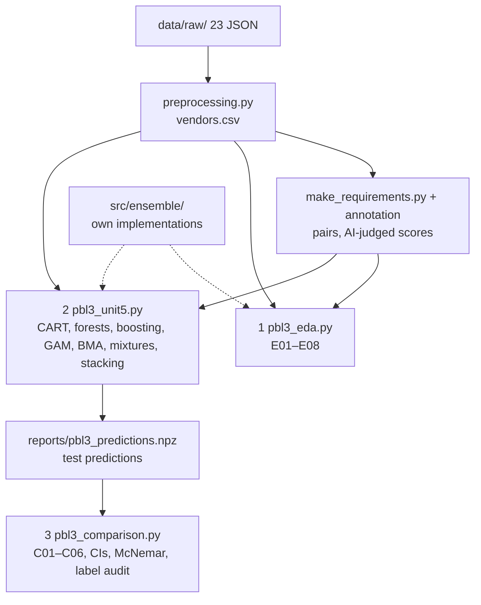

# PBL-3 viva pack: Intelligent Agent Mapping, Unit V (Combining Models)

One folder per rubric section (4 marks each, 20 in total). Each folder explains the topic in
depth, with the real numbers from this project, and ends with likely viva questions and answers.
PBL-3 uses the same data, features and train/test splits as [PBL-1](../pbl-1/README.md), so
every result can be compared directly with the PBL-1 single models.

| # | Rubric section | Folder | Key evidence |
|---|---|---|---|
| 1 | Problem Understanding & Dataset Familiarization | [01_problem_understanding](01_problem_understanding/README.md) | why one model is not enough here; what each Unit V method needs from the data |
| 2 | Exploratory Data Analysis & Insights | [02_eda_insights](02_eda_insights/README.md) | figures E01–E08, [eda_numbers.md](02_eda_insights/eda_numbers.md) |
| 3 | Unit Topic Implementation (CART, bagging/RF, boosting, GAM, BMA, mixtures, stacking) | [03_unit_topics_implementation](03_unit_topics_implementation/README.md) | `src/ensemble/`, figures U5_01–U5_12, [unit5_numbers.md](03_unit_topics_implementation/unit5_numbers.md) |
| 4 | Comparative Performance Analysis | [04_comparative_analysis](04_comparative_analysis/README.md) | figures C01–C06, [comparison_numbers.md](04_comparative_analysis/comparison_numbers.md) |
| 5 | Result Interpretation & Presentation | [05_results_interpretation_presentation](05_results_interpretation_presentation/README.md) | 10-minute talk plan, error analysis, limitations |

## Syllabus coverage (Unit V: Combining Models)

| Topic | Where (own implementation) | Section |
|---|---|---|
| **Bayesian model averaging** | `src/ensemble/bma.py` · `LinearBMA` (Zellner g-prior and BIC, all 64 linear models), `LogisticBMA` (1,024 logistic models); posterior concentration vs N | §3.8, U5_07 |
| **Boosting**: AdaBoost | `src/ensemble/boosting.py` · `fit_stump`, `AdaBoost` (Bishop 14.3; exponential-error identity checked) | §3.5, U5_09 |
| **Boosting**: gradient boosting | `boosting.py` · `GradientBoosting` (squared error and logistic loss, Newton leaf values, shrinkage) | §3.6, U5_04, U5_05, U5_12 |
| **Adaptive basis function models** | the common view of trees, boosting, GAM and experts; depth = order of interaction; partial dependence, permutation importance | §3.0, §3.6 |
| **CART** | `src/ensemble/tree.py` · `CART` (squared error and Gini, binary fast path, cost-complexity pruning, impurity importance) | §3.1, U5_01 |
| **Generalized additive models** | `src/ensemble/gam.py` · P-splines, backfitting = direct solve, edf, GCV vs grouped CV, GA²M interaction terms | §3.7, U5_06 |
| **Ensemble learning**: committees, bagging, random forests | `src/ensemble/committee.py` · `Forest` (bootstrap weights, out-of-bag, random feature subsets); E_COM vs E_AV | §3.2, U5_02 |
| **Ensemble learning**: bias–variance | bootstrap over training requirements | §3.3, U5_03 |
| **Ensemble learning**: stacking, voting | `src/pbl3_unit5.py` · `r8_stacking` (NNLS, Breiman 1996), `c6_stacking` (logistic meta-learner) | §3.4, U5_10 |
| *Extra*: conditional mixture models (Bishop 14.5) | `src/ensemble/mixture.py` · mixture of linear regressions (EM), mixture of experts with a logistic gate | §3.9, U5_08 |

## The project in 60 seconds

"PBL-1 scored buyer–vendor matches with one linear model (test R² 0.751) and classified
pharmacies with one logistic model (F1 0.935). PBL-3 asks whether **combining models** does
better. The EDA says it should for the score: being inside the radius is worth **+31 points
for the right shop type but +3 for the wrong one**, an interaction a linear model cannot
represent. I wrote CART, bagging, random forests, AdaBoost, gradient boosting, a P-spline GAM,
Bayesian model averaging and a mixture of experts myself, and checked each against
scikit-learn or theory in 10 tests. Trees and boosting **find** the interaction by themselves
(random forest 0.799, gradient boosting 0.791, stacking 0.806). The best model, though, is a
**GAM with the two interaction terms the trees revealed: R² 0.839**, and every term is still a
readable curve. BMA over all 64 linear models does not help (0.749): averaging models that all
miss the interaction cannot add it, and its weights concentrate on one model as data grows. For
pharmacies the PBL-1 logistic model is already at the ceiling. Every strong ensemble makes the
same few mistakes, and the label audit shows several of those are **wrong labels**, not model
errors. Combining helps when the members make different errors; here they mostly make the same
ones."

## Project flow: the order to run the files

Run every command from the project root. PBL-3 reads the Phase 1 outputs; it writes only to
`pbl-3/` and two files in `reports/`.



### 0. One-time setup (same as PBL-1; no new packages)

```powershell
python -m venv .venv
.venv\Scripts\activate
python -m pip install -r requirements.txt
```

If `data/processed/` is missing, first run the Phase 1 steps 1–3 in
[PBL-1](../pbl-1/README.md) (`audit.py`, `preprocessing.py`, `make_requirements.py`).

### 1–3. This PBL-3 pack

| Step | Command | Reads | Writes | Time |
|---|---|---|---|---|
| 1 | `python src/pbl3_eda.py` | `vendors.csv`, annotation sheet, `pairs.csv`, `requirements.csv` | `pbl-3/02_eda_insights/figures/E01–E08`, `eda_numbers.md` | ~40 s |
| 2 | `python src/pbl3_unit5.py` | same | `reports/pbl3_unit5_metrics.json`, `reports/pbl3_predictions.npz`, `figures/U5_*`, `unit5_numbers.md` | ~15 min |
| 3 | `python src/pbl3_comparison.py` | step 2's `pbl3_predictions.npz`, `label_audit_sample.csv` | `pbl-3/04_comparative_analysis/figures/C01–C06`, `comparison_numbers.md` | ~30 s |

Steps 1 and 2 are independent; step 3 needs step 2. On Windows, if the console cannot print
Unicode, set `$env:PYTHONIOENCODING = "utf-8"` first (the output files are UTF-8 either way).
Every number in the READMEs comes from these files. Seed 42 everywhere, so re-running reproduces
them exactly.

Most of step 2's time goes to the pharmacy random forest (500 trees on 441 columns) and the 5-fold
CV of AdaBoost and logistic gradient boosting.

### Tests

```powershell
python -m pytest tests/test_ensemble.py -q   # 10 tests for the PBL-3 implementations
python -m pytest tests -q                    # all 56 tests (PBL-1, PBL-2, PBL-3)
```

`tests/test_ensemble.py` checks: own CART = scikit-learn for regression and classification
(including the binary matrix-product path); the cost-complexity pruning path = scikit-learn's;
the stump = the brute-force minimum weighted error; AdaBoost's exponential error = Πₘ 2√(εₘ(1−εₘ))
and bounds the training error; gradient boosting = scikit-learn for squared and logistic loss;
committee error ≤ average member error; backfitting converges to the direct penalised
least-squares GAM; BMA's full model = OLS and the g-prior Bayes factor matches its formula; mixture
EM never decreases the likelihood and recovers two planted regression lines.

## New files

| File | Purpose |
|---|---|
| `src/ensemble/tree.py` | CART: sort and binary split search, sample weights, random feature subsets, weakest-link pruning, importance, readable text |
| `src/ensemble/committee.py` | bagging and random forests with out-of-bag predictions and member predictions |
| `src/ensemble/boosting.py` | weighted-error decision stump, AdaBoost, gradient boosting (squared / logistic) |
| `src/ensemble/gam.py` | P-spline and linear terms, "by" interaction terms, direct solve with edf/GCV, backfitting |
| `src/ensemble/bma.py` | subset enumeration, g-prior and BIC evidence, BMA mean and Student-t mixture intervals, logistic BMA |
| `src/ensemble/mixture.py` | mixture of linear regressions (EM, variance floor), two-expert mixture of experts |
| `src/pbl3_style.py` | shared plot style (same palette as PBL-1/2), Phase 1 data in the Phase 1 splits, metrics |
| `src/pbl3_eda.py`, `src/pbl3_unit5.py`, `src/pbl3_comparison.py` | the three steps above |
| `tests/test_ensemble.py` | 10 correctness tests |

## Other material to have open in the viva

- `pbl-3/03_unit_topics_implementation/unit5_numbers.md`: every table, generated
- `src/ensemble/boosting.py`: AdaBoost is ~30 lines that map one-to-one to Bishop 14.3
- `src/ensemble/tree.py` · `pruning_path`: weakest-link pruning in ~20 lines
- `pbl-1/`: the single models (OLS, kernel ridge, L2 logistic) that PBL-3 is compared against
